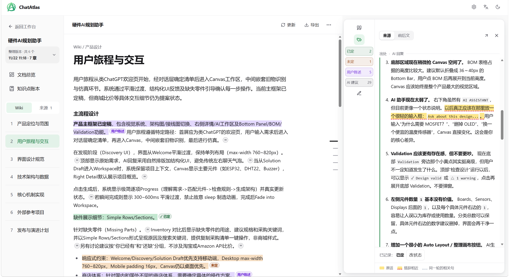
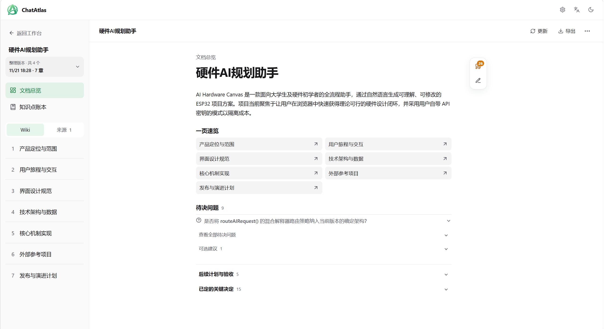
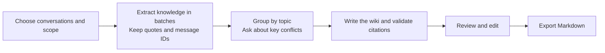

<p align="center">
  
</p>

<p align="center">
  <a href="README.md">简体中文</a> · <b>English</b> · <b>v0.1.7 Alpha</b>
</p>

<p align="center">
  <a href="https://github.com/CNZHM666/ChatAtlas/releases/download/v0.1.7/ChatAtlas-extension-v0.1.7.zip"><b>Download v0.1.7 ZIP</b></a>
  · <a href="#preview">Preview</a>
  · <a href="#install-on-chrome-or-edge">Install</a>
  · <a href="docs/en/CHANGELOG.md">Changelog</a>
  · <a href="https://github.com/CNZHM666/ChatAtlas/issues">Feedback</a>
</p>

<p align="center">
  <strong>Turn long, scattered AI conversations into a project wiki with verifiable citations and incremental updates.</strong><br>
  Export only the Markdown you need and hand it to a teammate, <strong>Codex</strong>, or <strong>Claude Code</strong> to pick up right where you left off.
</p>

> [!NOTE]
> **Alpha · Chrome / Edge.** Local reading, keyword search, and export require no AI key. Wiki generation uses your own model connection (BYOK). Long conversations can take a while to process, and output quality varies with the model and source material. Check key conclusions against their citations and back up your data before upgrading.

## Why use ChatAtlas?

- **Review decisions at the source.** Confirmed decisions, AI suggestions, and user reports are clearly labeled. Open **Check evidence** to read the original passage in context and resolve key conflicts yourself.
- **Knowledge ledger with incremental updates.** ChatAtlas extracts knowledge in batches and links each entry to its source message ID. Updates reuse eligible, validated reads and focus follow-up reads on uncovered material. You can preview affected chapters before applying changes.
- **Markdown built for project handoffs.** Export the project overview and selected chapters as a `.md` file, with citation IDs or original excerpts, ready for a teammate, Codex, or Claude Code. [See the Markdown template →](docs/en/examples/project-context-template.md)
- **Local-first, with AI on demand.** Conversations, the ledger, and the wiki are stored in your browser's IndexedDB. Reading, keyword search, and export run locally. When you generate or update a wiki, ChatAtlas sends the necessary material from your selected sources directly to your configured provider.

## Preview

<p align="center">
  
  <br><sub>Turn on source markers and click a citation to open the original conversation</sub>
</p>

<p align="center">
  
  <br><sub>Review a wiki claim alongside the original message and its surrounding context</sub>
</p>

<details>
<summary>Import demo and more screenshots</summary>

<p align="center">
  
  <br><sub>Import multi-platform conversations in the workbench</sub>
</p>

| Project overview | Conversation reader in dark mode |
|:---:|:---:|
|  |  |
| **Workbench** | **Web sidebar** |
|  |  |

</details>

## Quick start

1. **Choose your sources.** Configure and test a model in **Settings → AI connection**. Import your conversations, choose **Organize into a project document** in the workbench, then select your sources and describe your goal.
2. **Check the evidence.** Open **Check evidence** in a chapter to inspect the original passage in context and confirm decisions that affect next steps.
3. **Export Markdown.** In **Export**, pick the overview and chapters you need, include original excerpts if helpful, and share the file with a teammate or coding agent.

## Supported platforms and sources

| Source | File import | Automatic web capture |
| :--- | :--- | :--- |
| **ChatGPT** | ✅ Official export | ✅ Supported, with dedicated history sync |
| **Claude** | ✅ Official export | 🧪 Experimental |
| **Gemini** | ✅ Google Takeout JSON | 🧪 Experimental |
| **DeepSeek** | ✅ Official export | 🧪 Experimental |
| **Doubao** | — | 🧪 Experimental |
| **Kimi** | — | 🧪 Experimental |
| **Qwen (including the international site)** | — | 🧪 Experimental |
| **Generic Markdown / JSON** | ✅ Compatible conversation files | — |

Web capture turns on by default once the browser grants access to a supported site and can be paused anytime in Settings. Experimental capture only saves messages currently loaded on the page, so older history may be incomplete.

## How it works



- **Source material and generated content stay separate.** Original messages and versions, generated prose, and personal edits are stored as distinct records. Each confirmation is tied to its question, selected answer, and supporting evidence.
- **Updates preserve personal edits.** For chapters you have edited, ChatAtlas keeps your text intact and presents newly generated updates for review.
- **BYOK requests go directly to your provider.** API keys are stored in your browser. Wiki generation, optional semantic search, sidebar AI Q&A, and connection tests send requests directly to the provider you configure.

[Architecture](docs/en/ARCHITECTURE.md) · [AI workflow](docs/en/AI_WORKFLOWS.md) · [Privacy](docs/en/PRIVACY.md)

## Install on Chrome or Edge

**[Download v0.1.7 Alpha (ZIP)](https://github.com/CNZHM666/ChatAtlas/releases/download/v0.1.7/ChatAtlas-extension-v0.1.7.zip)** · [Release notes](https://github.com/CNZHM666/ChatAtlas/releases/tag/v0.1.7)

Chrome and Edge share the same ZIP. During Alpha, the extension is distributed via GitHub and loaded manually.

1. Download the ZIP and extract it to a permanent folder.
2. Open `chrome://extensions` or `edge://extensions` and enable **Developer mode**.
3. Click **Load unpacked** and select the folder that directly contains `manifest.json`. You can open or pin **ChatAtlas** from the browser's Extensions menu.

<details>
<summary>Download & unpack with Claude Code / Codex</summary>

Paste this prompt into an AI coding agent with terminal access, then load the folder it returns in your browser.

```text
Download the ChatAtlas v0.1.7 Alpha extension ZIP from this URL.
https://github.com/CNZHM666/ChatAtlas/releases/download/v0.1.7/ChatAtlas-extension-v0.1.7.zip
Extract it to a folder I can keep. Verify that the folder directly contains manifest.json, then give me its absolute path and the steps to load it in Chrome or Edge.
```

</details>

**Upgrading an existing install.** Back up your data in **Settings → Capture & data**, replace the files in your existing extension folder, and click reload on the Extensions page.

## Build from source

Requires **Node.js 22**.

```sh
npm ci
npm run check   # Validate and build, then load dist/ as an unpacked extension
npm run dev     # Start dev mode and load dist-dev/
```

[User guide](docs/en/GETTING_STARTED.md) · [Contributing](docs/en/CONTRIBUTING.md) · [MIT license](LICENSE) · [Third-party notices](docs/THIRD_PARTY_NOTICES.md)

## Community & Contributing

Share your workflow, generated wikis, and feedback on [LINUX DO](https://linux.do) or in [GitHub Discussions](https://github.com/CNZHM666/ChatAtlas/discussions). Bug reports, feature ideas, and PRs are all welcome—see [Contributing](docs/en/CONTRIBUTING.md) to get started. Thanks to the LINUX DO community for its support.
