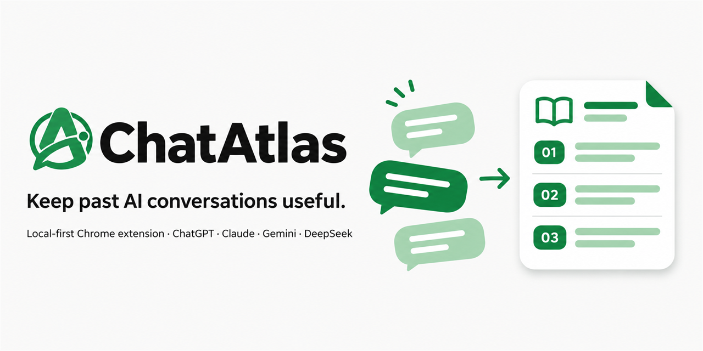
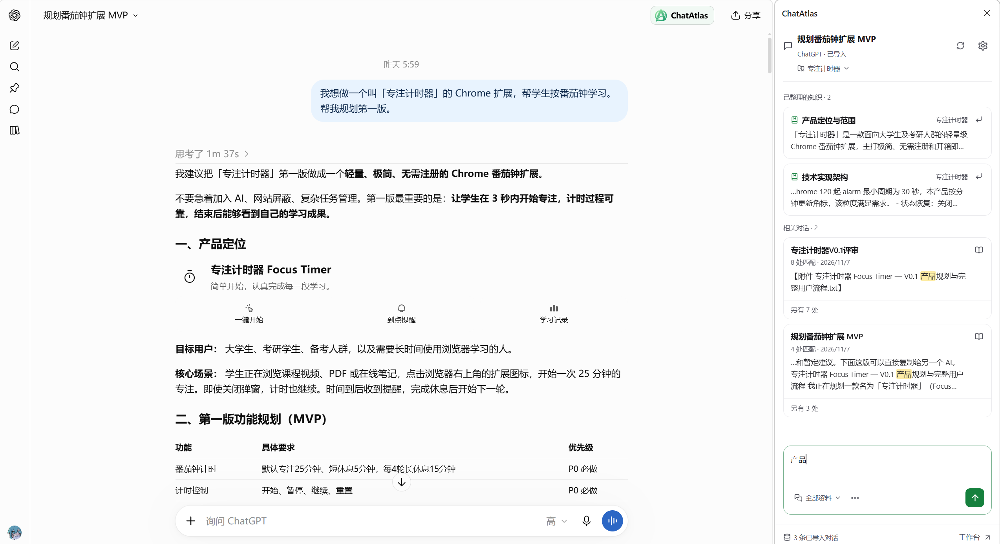
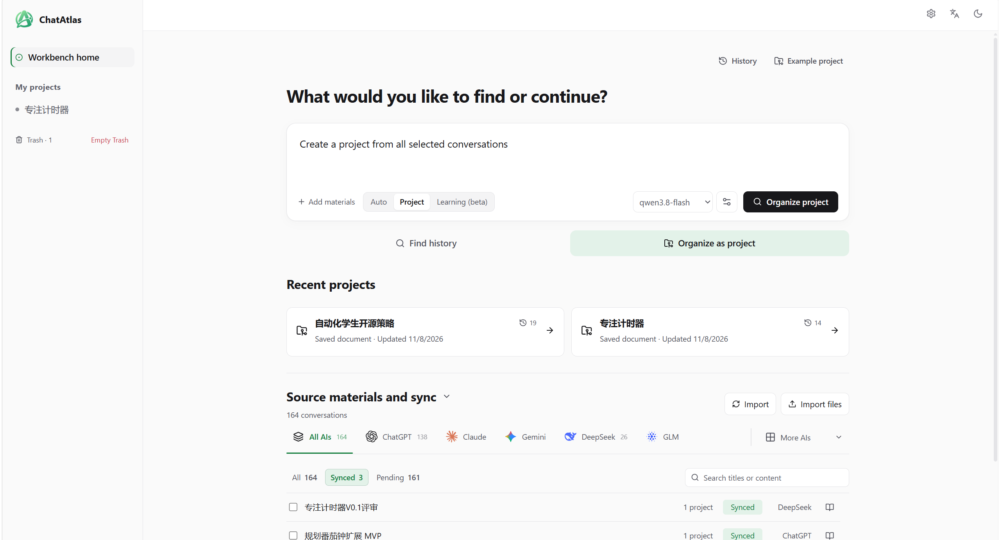
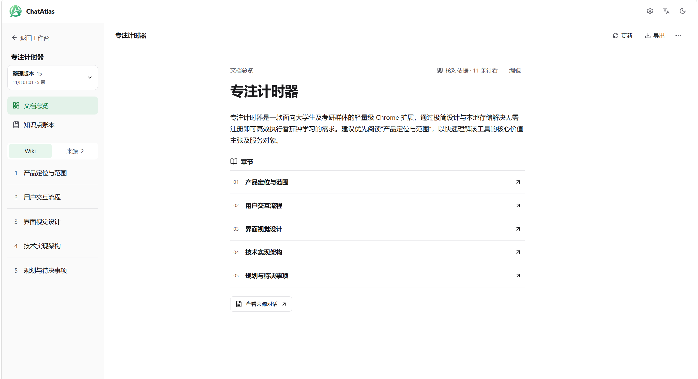
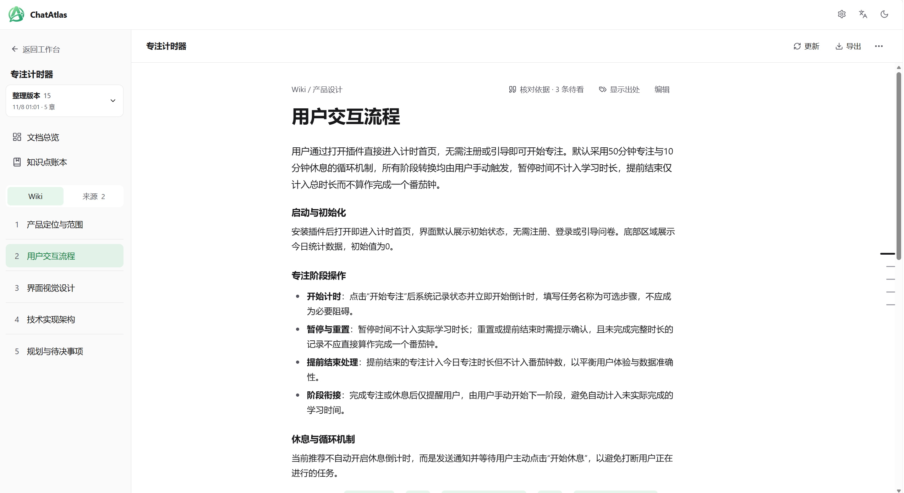
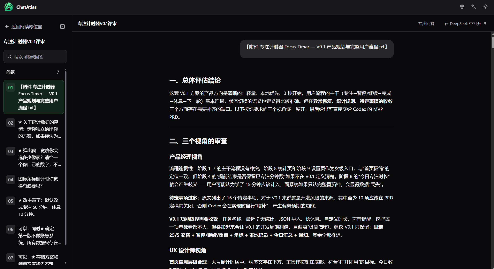
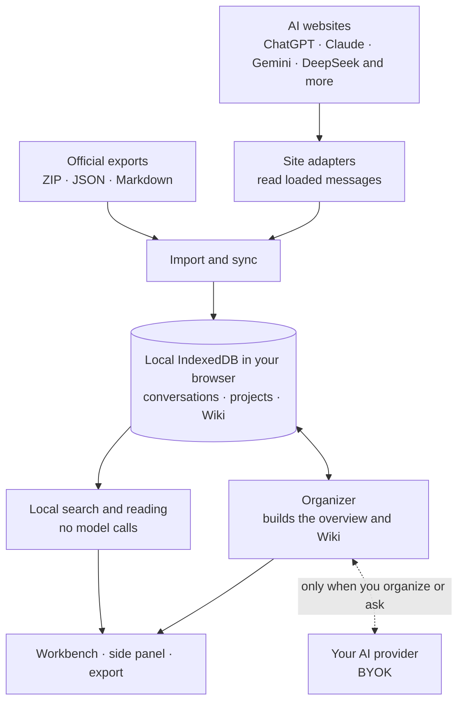

<p align="center">
  
</p>

<p align="center">
  <a href="README.md">简体中文</a> · <b>English</b>
</p>

<p align="center">
  <a href="https://github.com/CNZHM666/ChatAtlas/releases/latest"></a>
  <a href="LICENSE"></a>
  
  <a href="https://linux.do"></a>
</p>

<p align="center">
  <a href="https://github.com/CNZHM666/ChatAtlas/releases/latest"><b>Download</b></a>
  &nbsp;·&nbsp; <a href="#install-about-2-minutes">Install</a>
  &nbsp;·&nbsp; <a href="#first-use">First use</a>
  &nbsp;·&nbsp; <a href="#architecture-overview">Architecture</a>
  &nbsp;·&nbsp; <a href="docs/en/CHANGELOG.md">Changelog</a>
  &nbsp;·&nbsp; <a href="https://github.com/CNZHM666/ChatAtlas/issues">Feedback</a>
</p>

<br>

**Keep past conversations useful. Revisit what you have learned.**

- **Works right after install**: Basic search needs no AI key. Import or save conversations, then search titles and text locally and read the original discussions.
- **Your data stays local**: Conversations are saved in your browser, and there is no ChatAtlas server. Organizing documents uses your own API key (BYOK): material goes directly to the provider you choose.
- **Organize when you need to**: Turn selected discussions into a project overview and Wiki that trace back to their sources.

> [!NOTE]
> ChatAtlas is an early preview (0.1.2 Early Preview). Features, interactions and data structures will still change. Wiki organization is experimental: check what it writes against the sources. Back up local data before upgrading.

## A quick look



<p align="center"><sub>Open the side panel next to an AI website to find organized knowledge and related conversations</sub></p>

| Workbench: search history, organize projects, browse sources by AI | Project document: overview and chapters |
| :---: | :---: |
|  |  |
| **Wiki chapter: decisions and details by topic** | **Reader: the original conversation, in order** |
|  |  |

## What it does

- **Save conversations**: import official export files, or let supported AI websites save loaded conversations automatically. Everything stays in the current browser.
- **Find what was said**: keyword search covers titles and text; open a result to read the discussion in its original order, or locate it on the original website.
- **Side panel for the current conversation**: search local records, link a project, and fill the composer (never sent automatically, never overwriting a draft you typed).
- **Organize into a Wiki**: choose conversations and a goal to generate a project overview and Wiki. It asks you where your judgment is needed, before and while writing; you preview before saving.
- **Learning record (beta)**: when you choose the Learning type, it organizes what you learned by point, with your exercises, your mistakes and recall questions.
- **Hand off to another AI**: export the overview and selected chapters as Markdown, plain text, HTML (printable to PDF) or JSON, and attach the file elsewhere. Export makes no model call.

What each part is for:

| Part | Where you open it | Purpose |
| --- | --- | --- |
| Workbench home | The extension icon | One input to search past discussions or get an answer from them; manage source material and sync; pick up the last reading or project |
| Discover topics | **Discover topics** on the home page | AI finds projects worth organizing and topics worth reviewing in your recent conversations, each listing its sources for you to check first (needs an AI connection) |
| Conversation reader | A search result or the source list | Read a whole conversation in its original question-and-answer order, and locate it on the original website |
| Project document | **Organize into a project** on the home page | Choose sources and a goal, answer the questions before writing, and generate an overview and Wiki; review, edit, update and export |
| Chapter reading | Inside a project document | Read along Wiki chapters and their originals, going straight on to the next chapter |
| Side panel | Beside an AI website | Local search for the current conversation, project links, and filling the composer |

The usual path: **search or ask → read the original conversation → organize a project document → read along chapters and sources → export to another AI**. Searching, reading and exporting need no AI key. Product decisions follow the [product principles](docs/en/PRODUCT_PRINCIPLES.md).

## Supported platforms

| Method | Platforms |
| --- | --- |
| Import official exports | ChatGPT (ZIP/JSON), Claude, Gemini (Google Takeout JSON), DeepSeek; Markdown/JSON transcripts from other AIs |
| Automatic website saving | ChatGPT (dedicated history list and body sync); Claude, Gemini, DeepSeek, Doubao, Kimi and Qianwen (including Qwen international) in beta |

Website adapters run automatically after browser website permission; pause or resume each platform in **Settings → Capture & data → Automatic page capture**. Except on ChatGPT, website saving saves currently loaded messages, not guaranteed full history; for a long conversation, load earlier messages on the website first. The newer platforms have not each been accepted while signed in, and a website redesign can break saving; file import is the fallback. Saving makes no model call.

## Install (about 2 minutes)

ChatAtlas is not on the Chrome Web Store yet, so it is loaded in Developer mode. Edge and other Chromium browsers work the same way (use `edge://extensions`). You can also hand [a ready-made prompt](#let-an-ai-install-it-for-you) to an AI and let it do this for you.

1. **Download**: open the [latest Release](https://github.com/CNZHM666/ChatAtlas/releases/latest) and, under Assets, download `ChatAtlas-extension-v0.1.2.zip`. Not `Source code`: that cannot be loaded directly.
2. **Extract**: unzip it into a folder you will keep, such as `Documents/ChatAtlas`. The folder should contain `manifest.json` directly. Do not delete or move it after loading, or the extension stops working.
3. **Open the extensions page**: type `chrome://extensions` in the address bar.
4. **Turn on Developer mode** with the switch at the top right.
5. **Load it**: click **Load unpacked** at the top left and choose the folder from step 2 (the level that contains `manifest.json`).
6. **Pin the icon**: click the puzzle icon in the toolbar and pin ChatAtlas. Click the icon to open the workbench.

Chrome may ask on startup whether to disable developer-mode extensions; keep it. If loading says the manifest is missing or unreadable, you chose the wrong level: pick the folder that directly contains `manifest.json`.

**Upgrading**: first download a backup from **Settings → Capture & data** (it contains no API key). Then replace the folder's contents with the new ZIP and click the reload button on the ChatAtlas card in `chrome://extensions`. Your data lives in the browser and survives this; do not click **Remove**, which deletes local data.

### Let an AI install it for you

New to Developer mode? Copy the text below to an AI assistant. An AI that can use your computer (such as Claude Code or Codex) can download, extract and check the files for you; ChatGPT, Claude or DeepSeek on the web will walk you through each step and help with any error. The last two steps in `chrome://extensions`, turning on Developer mode and loading the extension, are usually yours to click.

```text
Please help me install the Chrome extension ChatAtlas (open source: https://github.com/CNZHM666/ChatAtlas).

1. Open https://github.com/CNZHM666/ChatAtlas/releases/latest and, under Assets, download the file named ChatAtlas-extension-v<version>.zip. Use only this official address: not Source code, and not any other website.
2. Extract the ZIP into a folder I will keep (for example Documents/ChatAtlas) and check that the folder directly contains manifest.json.
3. Tell me the folder's full path, then guide me: open chrome://extensions in Chrome, turn on Developer mode at the top right, click Load unpacked, choose that folder, and pin the ChatAtlas icon to the toolbar.

If you cannot use my computer directly, write out each step for me to follow, and help me work out any error. Do not change any file in the extension, and do not ask me for any password or API key.
```

## First use

1. Click the extension icon to open the workbench, then import an export file or open a supported AI website to save conversations automatically.
2. Searching and reading need no API key. To organize documents, choose a provider in **Settings → AI connection**, enter your key, pick a model and test the connection.
3. Organize a project document: choose sources, write a goal, answer the questions before writing, then review and save the result.

Never commit private backups or exports to GitHub.

## How a Wiki is organized

1. **Choose material**: select source conversations (up to 24, across platforms) and write what you want organized.
2. **Before writing**: other projects and products named in the material are listed, and you tick the ones to leave out of the Wiki, with no model involved. The model then asks about the few points that change the conclusions, such as which of two roadmaps counts or which stage a limit belongs to. Your answers outrank the AI's inferences.
3. **While writing**: a point it cannot state faithfully is asked about at once; your answer revises only the paragraphs concerned, not the whole chapter.
4. **Review and save**: preview, then save. Later you can rewrite a chapter or update from new material; your own edits are protected.

The document contains:

- **Project overview**: at a glance, the **current baseline** (doing now / not now / done when), key decisions and source scope.
- **Wiki chapters**: organized by subject, each point explained once, with the source's numbers, code and conditions kept.
- **Sentence marks**: 〔已定〕 decided by you, 〔未定〕 still open, 〔此前〕 replaced by a later plan, 〔你〕 your own view or report, 〔资料〕 material you pasted. Unmarked text is the AI's suggestion or analysis. "Done" means you reported it, not that the code was verified.
- **Document information and evidence notes**: source scope, automatic check results and messages no point was extracted from. Automatic checks can miss problems and can report false ones.

Citations take you back to the original to check; they do not prove a suggestion was adopted. Long material takes substantial time and tokens; successful reading and writing are reused for the same input, and a failure keeps the finished parts.

## Architecture overview

ChatAtlas is a frontend-only Manifest V3 extension. Your data moves only inside your browser; selected material goes directly to the AI provider you configured only when you organize a document or ask a question.



| Module | Responsibility |
| --- | --- |
| `src/content/` | Site adapters: save loaded conversations, locate original messages, fill the input box |
| `src/background/` | Extension entry points, site permissions, sync scheduling |
| `src/sync/` · `src/storage/` | Import official exports and web history into IndexedDB, keeping source versions |
| `src/search/` | Local full-text search and ranking over titles and text |
| `src/ai/` | BYOK provider connections; the Wiki's first read, outline planning, writing and source checks |
| `src/canvas/` · `src/sidecar/` | Workbench, reader and project document views, and the side panel next to AI websites |
| `src/export/` | Export the overview and chapters as Markdown, plain text, HTML or JSON |

A few design constraints:

- **Sources first**: generated explanations, original conversations and your own edits are stored separately, and conclusions cite the sources they came from.
- **AI suggests, you decide**: saving a document never turns an AI suggestion into your decision, and chapters you edited are protected during updates.
- **Stays in its lane**: it never sends messages for you, never overwrites a draft in the input box, and never calls a model in the background.

See the [architecture notes](docs/en/ARCHITECTURE.md) and [AI workflows](docs/en/AI_WORKFLOWS.md) for details.

## Data and privacy

- Conversations, projects, saved items and AI settings stay in the current browser. There is no cloud sync and no ChatAtlas server.
- Material is sent only when you use AI (organizing, semantic search), and then directly to the provider you chose.
- Searching, reading and exporting make no model call.
- Back up before uninstalling the extension or clearing browser data.

See the [privacy notes](docs/en/PRIVACY.md). Report security problems privately as described in the [security policy](SECURITY.md).

## Current limitations

- Wiki quality varies with the material and the model, and repeated runs on the same material can differ; check key conclusions against the originals.
- Automated tests use a mocked provider; they do not establish completeness, cost or success rates on real long conversations or every model.
- Automatic website saving depends on each site's page structure and can stop working after a redesign.
- Organizing time depends on material length, the model and provider rate limits; long material can take a while. No benchmark is published yet. Search and reading need no generation.
- **Learning mode (beta)**: choose **Learning (beta)** as the document type to organize study conversations into numbered knowledge cards, exercises, mistakes and recall questions. Its layout and extraction are still changing; **Auto** organizes as a project for now.

## Build from source

Use Node.js 22 and npm:

```bash
npm ci
npm run check
```

Then load `dist/` in Chrome. For development, run `npm run dev` and load `dist-dev/`. No `.env` or backend is needed.

```bash
npm run check:public
npm run eval:wiki -- <cases.json> <export.md>
```

`check:public` verifies the public source holds no credentials, machine paths or files outside its list. `eval:wiki` scores an exported Wiki against cases you label yourself and averages several exports; keep cases and exports local, since they contain private material. Release steps are in the [release checklist](docs/en/RELEASE_CHECKLIST.md).

## Documentation and feedback

[Getting started](docs/en/GETTING_STARTED.md) · [Documentation](docs/en/README.md) · [Export guide](docs/en/CONTEXT.md) · [Architecture](docs/en/ARCHITECTURE.md) · [AI workflows](docs/en/AI_WORKFLOWS.md) · [Contributing](docs/en/CONTRIBUTING.md) · [Security](SECURITY.md) · [Changelog](docs/en/CHANGELOG.md)

Report reproducible problems in Issues with the extension and browser version, import method, model, steps and expected result. Remove API keys and private conversation text. Use the feature request template for ideas.

## Community

Come talk about ChatAtlas on [LINUX DO](https://linux.do) or in [GitHub Discussions](https://github.com/CNZHM666/ChatAtlas/discussions): share how you use it, the Wikis you organize, or ideas. Thanks to the LINUX DO community for its support.

## License

[MIT](LICENSE). Third-party components keep their own licenses; see the [dependency notices](docs/THIRD_PARTY_NOTICES.md).
