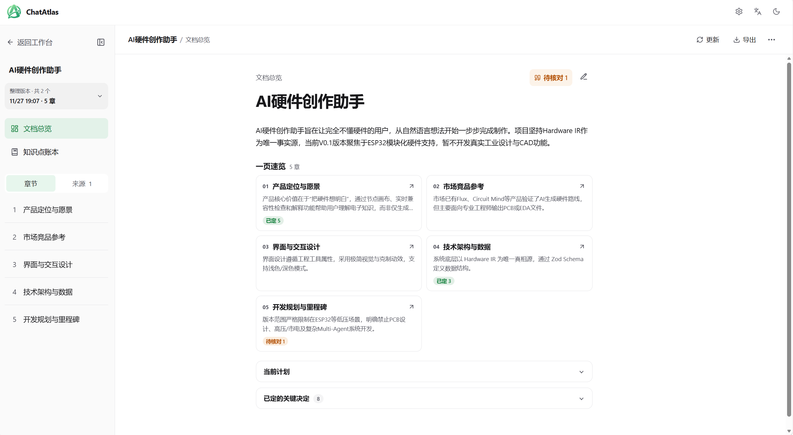
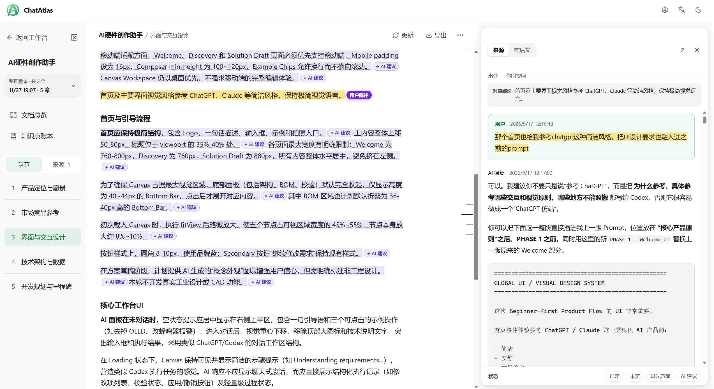
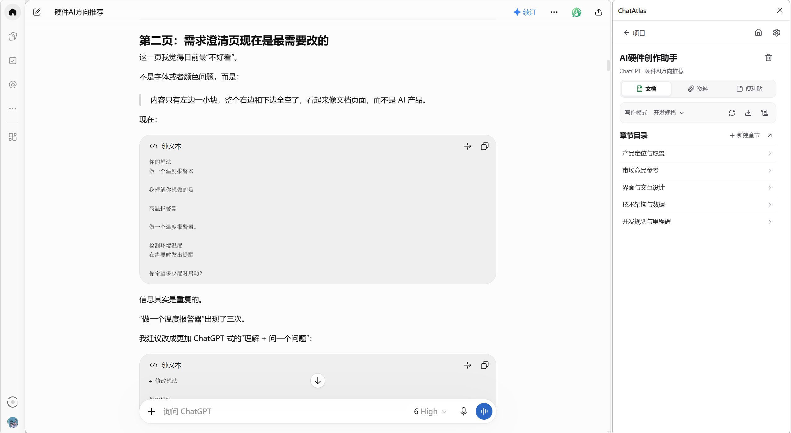
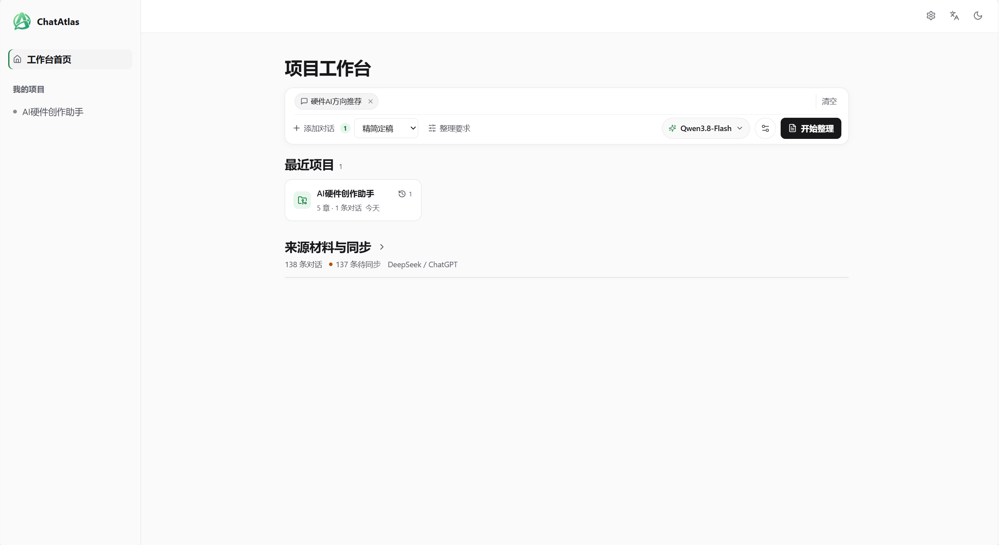
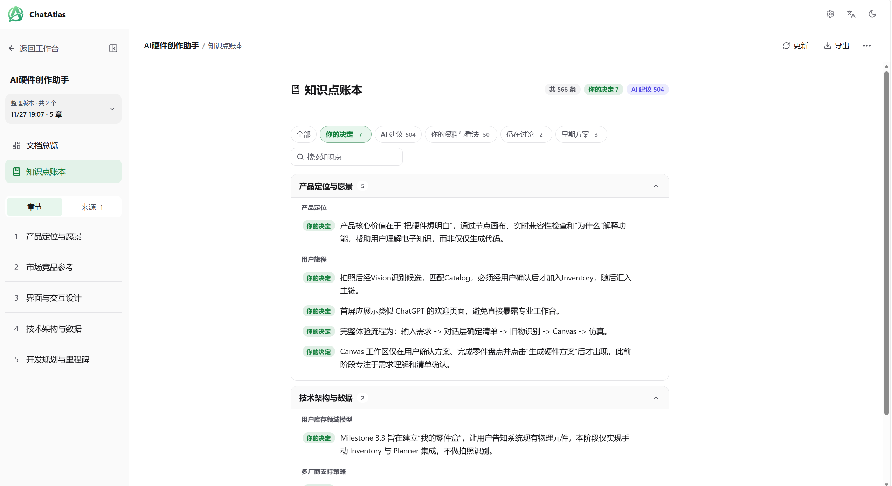
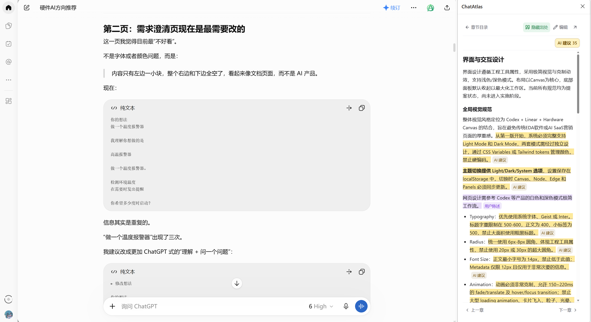
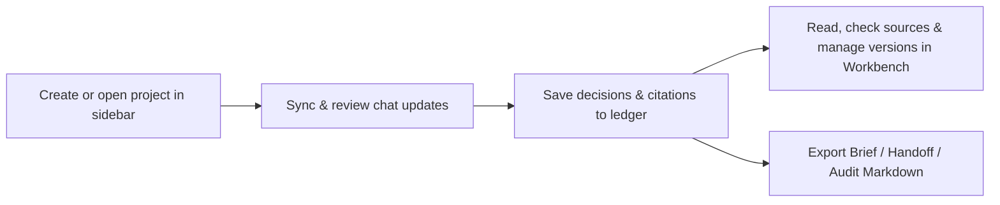

<p align="center">
  
</p>

<p align="center">
  <a href="README.md">简体中文</a> · <b>English</b> · <b>v0.1.8 Alpha</b>
</p>

<p align="center">
  <a href="https://cnzhm666.github.io/ChatAtlas/?lang=en#/overview"><b>Live demo</b></a>
  · <a href="https://github.com/CNZHM666/ChatAtlas/releases/download/v0.1.8/ChatAtlas-extension-v0.1.8.zip">Download v0.1.8 ZIP</a>
  · <a href="#preview">Preview</a>
  · <a href="#install-on-chrome-or-edge">Install</a>
  · <a href="docs/en/CHANGELOG.md">Changelog</a>
  · <a href="https://github.com/CNZHM666/ChatAtlas/issues">Feedback</a>
</p>

<p align="center">
  <strong>Start a project in ChatGPT, continue in Claude, and keep one verifiable Markdown document.</strong><br>
  ChatAtlas is a local-first Chrome / Edge extension. Turn multi-platform AI chats into a structured project wiki with verifiable citations, a knowledge ledger, project files, and three Markdown export modes built for teammates, <strong>Codex</strong>, or <strong>Claude Code</strong>.
</p>

> [!NOTE]
> **Alpha · Chrome / Edge.** Local reading, keyword search, project files, sticky notes, and Markdown export require no AI key. Wiki generation and incremental updates use your own model connection (BYOK). Check key conclusions against their citations and back up your data before upgrading.

## Why use ChatAtlas?

- **Native sidebar workspace beside your AI chats.** Create projects, review incremental updates from the current conversation, read chapters with an in-chapter outline and source markers, and keep **Files** (with drag, paste, and auto-saved chat uploads) and **Sticky Notes** right next to the chat—separate from formal wiki prose.
- **Full Workbench for deep review and traceability.** Browse the one-page project **Overview**, filter **Your Decisions** vs **AI Suggestions** in the **Knowledge Ledger**, and inspect every claim side by side with the original conversation message and surrounding context.
- **Three Markdown export modes (copy or download).** Switch between **Brief** (clean reading & quick context), **Handoff** (technical specs, confirmed decisions, and compact locators for Codex / Claude Code), and **Audit** (full overview, attribution marks, excerpts, and check details) in both the Workbench and the sidebar—without regenerating.
- **Local-first, with BYOK AI on demand.** Conversations, the knowledge ledger, wiki versions, files, and notes stay in your browser's IndexedDB. Reading, keyword search, and export run locally. When you generate or update a wiki, only the selected material is sent directly to your configured provider.

## Preview

**[Try the English demo](https://cnzhm666.github.io/ChatAtlas/?lang=en#/overview)** · No installation or API key required. Explore the project overview, Knowledge Ledger, side-by-side citations, and 3-mode Markdown export.

<p align="center">
  
  <br><sub>Project overview: one-page chapter cards, confirmed decisions, and items awaiting review</sub>
</p>

<p align="center">
  
  <br><sub>Evidence review: inspect attribution marks alongside the original message and surrounding context</sub>
</p>

<p align="center">
  
  <br><sub>Native sidebar: Document, Files, and Sticky Notes tabs, writing mode selector, incremental update, and Markdown export</sub>
</p>

<details>
<summary>More screenshots: Workbench home, Knowledge Ledger, and Sidebar chapter reading</summary>

| Project Workbench | Knowledge Ledger |
|:---:|:---:|
|  |  |
| **Sidebar chapter reading & source marks** | **Multi-platform sidebar workspace** |
|  |  |

</details>

## Quick start

1. **Start a project.** Open the ChatAtlas side panel on any supported AI site and click **New** (or organize existing conversations from the **Project Workbench**). Configure a model in **Settings → AI settings** when you are ready to generate or update a wiki.
2. **Generate or review updates.** Generate a first wiki from the current conversation in the background, or click the update icon to preview new/changed points with verbatim source quotes before saving.
3. **Keep files & notes beside your chat.** Switch to the **Files** tab to auto-save uploads from the chat (or drop / `Ctrl+V` files directly) and drag saved assets back into another AI composer; jot quick thoughts in **Sticky Notes**.
4. **Export in the right mode.** Open **Export** in either the sidebar or Workbench, choose **Brief**, **Handoff**, or **Audit**, and copy Markdown or download the `.md` file.

## Supported platforms and sources

| Source | File import | Automatic web capture & sidebar |
| :--- | :--- | :--- |
| **ChatGPT** | ✅ Official export | ✅ Supported, with dedicated history sync |
| **Claude** | ✅ Official export | 🧪 Experimental |
| **Gemini** | ✅ Google Takeout JSON | 🧪 Experimental |
| **DeepSeek** | ✅ Official export | 🧪 Experimental |
| **Doubao** | — | 🧪 Experimental |
| **Kimi** | — | 🧪 Experimental |
| **Qwen (including Qwen Intl)** | — | 🧪 Experimental |
| **Generic Markdown / JSON** | ✅ Compatible conversation files | — |

Web capture runs by default once the browser grants access to a supported site. To stop capture for a site, change ChatAtlas’s site access in the browser. Experimental capture only saves messages currently loaded on the page, so older history may be incomplete.

## How it works



- **Source material and generated prose stay separate.** Original messages, source versions, knowledge units, generated chapters, personal edits, project files, and sticky notes are stored as distinct records. Every confirmation records its question, answer, and source quote.
- **Updates protect personal edits.** Manually edited chapters are never silently overwritten; incremental updates preview every proposed addition or revision before writing.
- **BYOK requests go directly to your provider.** API keys stay in your browser. Generation, incremental previews, optional semantic search, and connection tests talk directly to the provider you configure.

[Architecture](docs/en/ARCHITECTURE.md) · [AI workflow](docs/en/AI_WORKFLOWS.md) · [Privacy](docs/en/PRIVACY.md)

## Install on Chrome or Edge

**[Download v0.1.8 Alpha (ZIP)](https://github.com/CNZHM666/ChatAtlas/releases/download/v0.1.8/ChatAtlas-extension-v0.1.8.zip)** · [Release notes](https://github.com/CNZHM666/ChatAtlas/releases/tag/v0.1.8)

Chrome and Edge share the same ZIP. During Alpha, the extension is distributed via GitHub and loaded manually.

1. Download the ZIP and extract it to a permanent folder.
2. Open `chrome://extensions` or `edge://extensions` and enable **Developer mode**.
3. Click **Load unpacked** and select the folder that directly contains `manifest.json`. You can open or pin **ChatAtlas** from the browser's Extensions menu.

<details>
<summary>Download & unpack with Claude Code / Codex</summary>

Paste this prompt into an AI coding agent with terminal access, then load the folder it returns in your browser.

```text
Download the ChatAtlas v0.1.8 Alpha extension ZIP from this URL.
https://github.com/CNZHM666/ChatAtlas/releases/download/v0.1.8/ChatAtlas-extension-v0.1.8.zip
Extract it to a folder I can keep. Verify that the folder directly contains manifest.json, then give me its absolute path and the steps to load it in Chrome or Edge.
```

</details>

**Upgrading an existing install.** Back up your data in **Settings → Local data**, replace the files in your existing extension folder, and click reload on the Extensions page.

## Build from source

Requires **Node.js 22**.

```sh
npm ci
npm run check   # Validate and build, then load dist/ as an unpacked extension
npm run dev     # Start dev mode and load dist-dev/
```

[User guide](docs/en/GETTING_STARTED.md) · [Contributing](docs/en/CONTRIBUTING.md) · [MIT license](LICENSE) · [Third-party notices](docs/THIRD_PARTY_NOTICES.md)

## Community & Contributing

Share your workflow, generated wikis, and feedback on [LINUX DO](https://linux.do) or in [GitHub Discussions](https://github.com/CNZHM666/ChatAtlas/discussions). Bug reports, feature ideas, and PRs are all welcome—see [Contributing](docs/en/CONTRIBUTING.md) to get started. Thanks to the LINUX DO community for its support.
