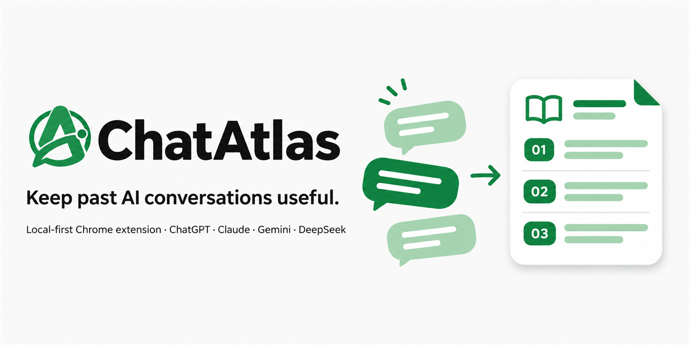
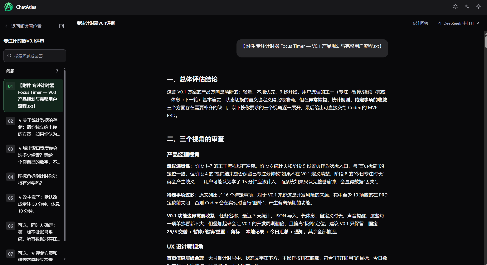
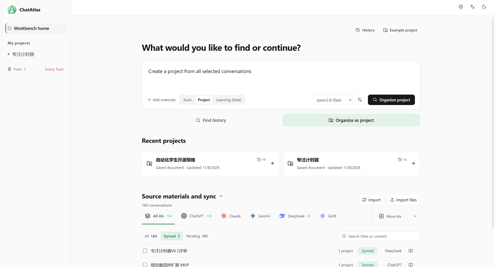
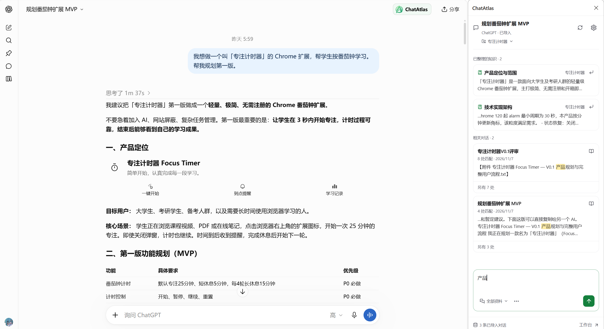
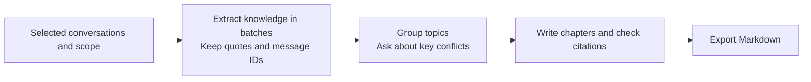

  

  <a href="README.md">简体中文</a> · <b>English</b> · <b>v0.1.6 Alpha</b>

  <a href="https://github.com/CNZHM666/ChatAtlas/releases/download/v0.1.6/ChatAtlas-extension-v0.1.6.zip"><b>Download the Alpha ZIP</b></a>
  · <a href="#install-on-chrome-or-edge">Install</a>
  · <a href="docs/en/CHANGELOG.md">Changelog</a>
  · <a href="https://github.com/CNZHM666/ChatAtlas/issues">Feedback</a>

**Turn scattered AI conversations into a Markdown project Wiki you can verify and share.**

Select conversations and generate an overview, themed chapters, and source citations. Open **Check evidence** to read the quoted passage in context, then export a `.md` file for a teammate, Codex, or Claude Code. Basic search needs no AI key.

> [!NOTE]
> **Alpha · Chrome / Edge.** Wiki generation uses your own provider and API key (BYOK). Check important conclusions against the sources and back up your data before upgrading.

## Install on Chrome or Edge

**[Download ChatAtlas (ZIP)](https://github.com/CNZHM666/ChatAtlas/releases/download/v0.1.6/ChatAtlas-extension-v0.1.6.zip)** · [Release notes](https://github.com/CNZHM666/ChatAtlas/releases/tag/v0.1.6)

1. Download the ZIP and extract it to a folder you can keep.
2. In the address bar, enter `chrome://extensions` for **Chrome** or `edge://extensions` for **Edge**. Turn on **Developer mode**.
3. Click **Load unpacked** and choose the extracted folder containing `manifest.json`.

Open **ChatAtlas** from the browser's Extensions menu. The same ZIP works in both browsers. This Alpha build is distributed through GitHub and loaded manually.

Already installed? Export a backup from **Settings → Capture & data**, replace the files in the existing extension folder, then reload ChatAtlas on the Extensions page.

## Generate your first Markdown file

1. **Choose material.** Import conversations and select **Organize into a project document** in the workbench. Choose the sources and describe your goal. Configure and test a model in **Settings → AI connection** before generating.
2. **Check evidence.** Open the quoted messages alongside the chapter. Confirmed decisions, AI suggestions, and user-reported progress carry distinct labels. You can settle key conflicts yourself.
3. **Export Markdown.** Select the overview and Wiki chapters in **Export**. Keep citation IDs or include original excerpts. [See the Markdown structure](docs/en/examples/project-context-template.md)

Import conversations

Show sources in the Wiki

  
   Wiki chapter and evidence controls · focus timer example

More screenshots

| Project overview | Original conversation |
|:---:|:---:|
|  |  |
| **Workbench** | **Web sidebar** |
|  |  |

## Wiki generation architecture

- **Knowledge ledger.** A point links the generated text to the original message. Originals, generated prose, and personal edits are saved separately. A confirmation applies to its specific decision.
- **Batched generation and incremental updates.** Validated reads can be reused. Recovery targets gaps, and source updates can be previewed before adoption.
- **Local storage and on-demand AI.** IndexedDB stores conversations, the ledger, and the Wiki. When you start generation, ChatAtlas sends the selected material to your configured provider. Reading, basic search, and export run locally.

[Architecture](docs/en/ARCHITECTURE.md) · [AI workflow](docs/en/AI_WORKFLOWS.md) · [Privacy](docs/en/PRIVACY.md)

## Supported sources

- **File import.** ChatGPT, Claude, Gemini (Google Takeout JSON), DeepSeek, and compatible Markdown or JSON conversation files.
- **Web capture.** ChatGPT supports history sync. Claude, Gemini, DeepSeek, Doubao, Kimi, and Qwen are experimental. Supported sites run automatically after browser website permission is granted. Experimental capture saves currently loaded messages, not guaranteed full history.

## Build from source

Use Node.js 22. Run `npm ci` and `npm run check`, then load `dist/`. For development, run `npm run dev` and load `dist-dev/`.

[User guide](docs/en/GETTING_STARTED.md) · [Contributing](docs/en/CONTRIBUTING.md) · [MIT license](LICENSE) · [Third-party notices](docs/THIRD_PARTY_NOTICES.md)

## Community

Come talk about ChatAtlas on [LINUX DO](https://linux.do) or in [GitHub Discussions](https://github.com/CNZHM666/ChatAtlas/discussions): share how you use it, the Wikis you organize, or ideas. Thanks to the LINUX DO community for its support.
