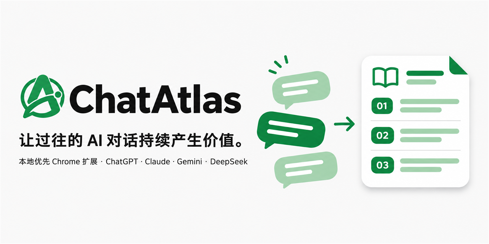
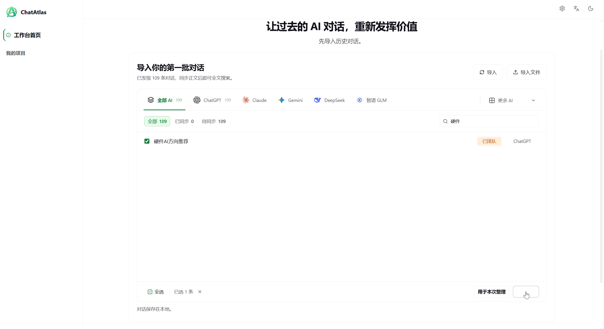
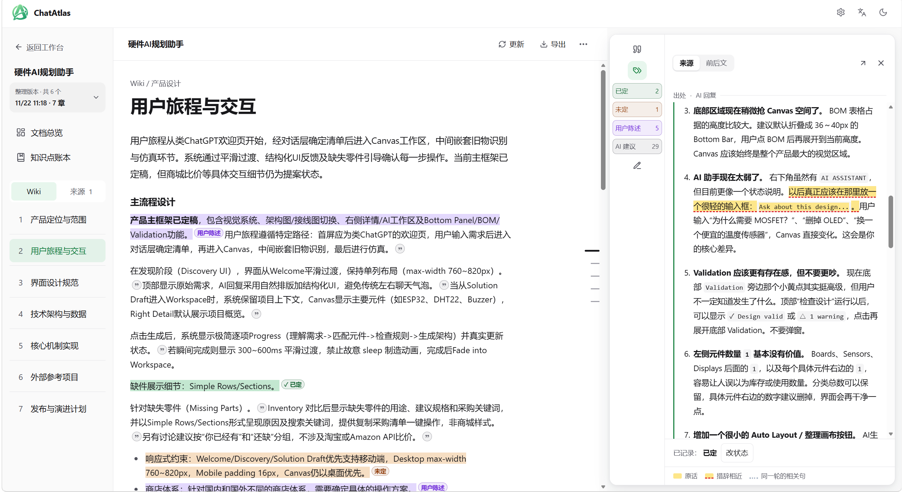
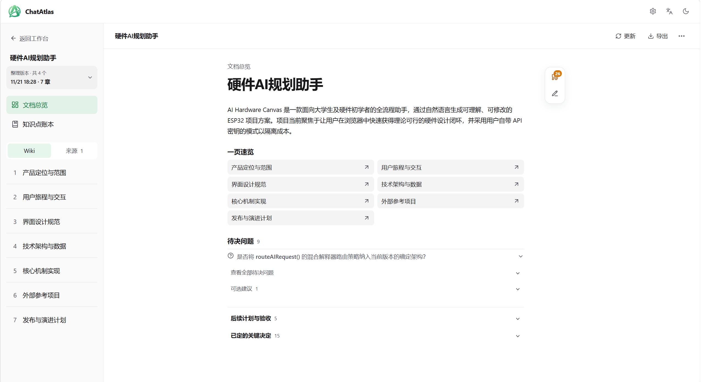
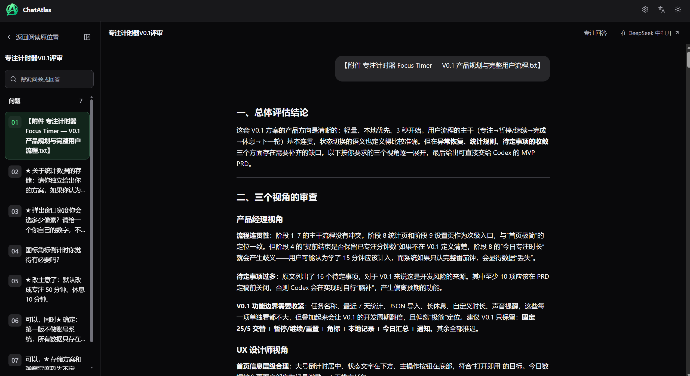
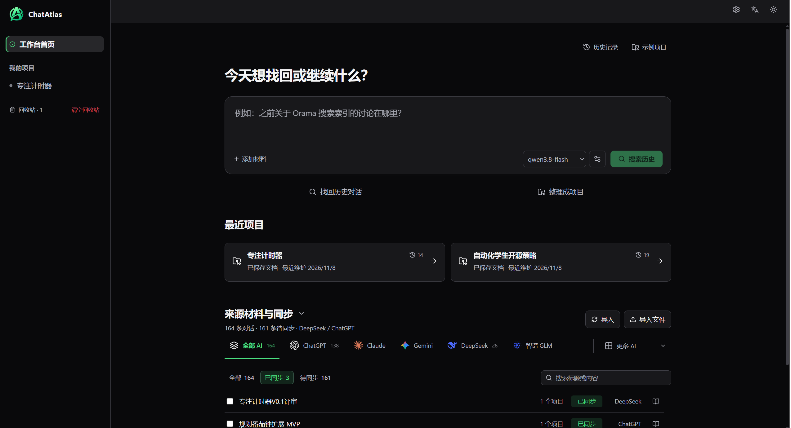
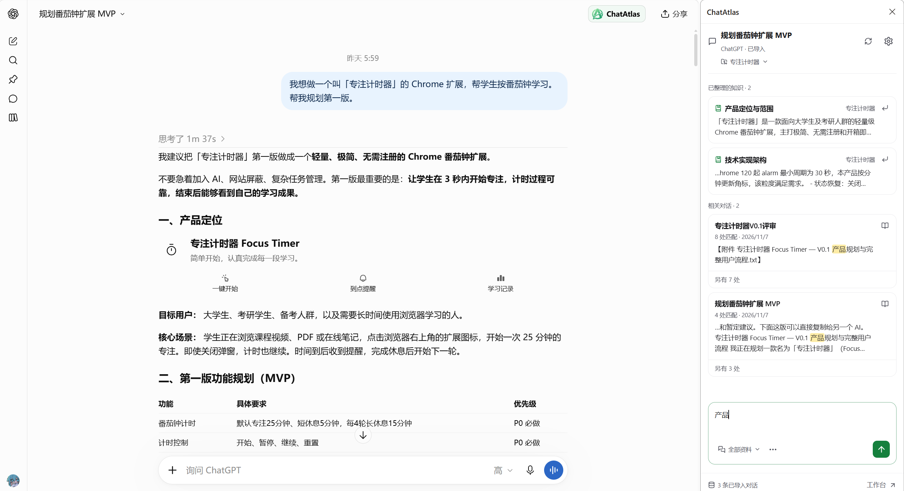
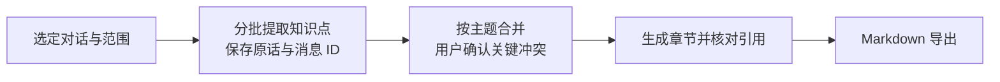

  

  <b>简体中文</b> · <a href="README.en.md">English</a> · <b>v0.1.6 Alpha</b>

  <a href="https://github.com/CNZHM666/ChatAtlas/releases/download/v0.1.6/ChatAtlas-extension-v0.1.6.zip"><b>下载 Alpha 安装包</b></a>
  · <a href="#安装到-chrome-或-edge">安装</a>
  · <a href="CHANGELOG.md">更新记录</a>
  · <a href="https://github.com/CNZHM666/ChatAtlas/issues">反馈</a>

**把散落在多个 AI 对话里的项目讨论，整理成一份可核对、可导出的 Markdown。**

选择对话，生成带总览、主题章节和来源引用的 Wiki。点击「核对依据」可打开原话和前后文，检查决定和建议的依据。核对后导出 `.md`，交给队友、Codex 或 Claude Code 接着做。基础搜索不需要 AI Key。

> [!NOTE]
> **Alpha 测试版 · Chrome / Edge**。Wiki 生成需要你自己的模型连接（BYOK）。生成质量随模型和材料而变，请核对关键结论，升级前先备份。

## 安装到 Chrome 或 Edge

**[下载 ChatAtlas 安装包（ZIP）](https://github.com/CNZHM666/ChatAtlas/releases/download/v0.1.6/ChatAtlas-extension-v0.1.6.zip)** · [查看版本发布页](https://github.com/CNZHM666/ChatAtlas/releases/tag/v0.1.6)

1. 下载 ZIP，解压到一个以后还会保留的文件夹。
2. 在浏览器地址栏输入 **Chrome** 的 `chrome://extensions` 或 **Edge** 的 `edge://extensions`，打开「开发者模式」。
3. 点击「加载已解压的扩展程序」，选择刚解压出来的文件夹。选对后，文件夹里能看到 `manifest.json`。

安装后，从浏览器的扩展菜单打开 **ChatAtlas**。两个浏览器使用同一个安装包。现阶段通过 GitHub 提供 Alpha 测试版，需要手动加载。

已安装旧版？先在「设置 → 采集与数据」导出备份，再用新版文件替换原安装目录中的文件，最后在扩展页刷新 ChatAtlas。

## 生成第一份 Markdown

1. **选择材料**。导入对话，在工作台选择「整理为项目文档」，勾选来源并写下目标。首次生成前到「设置 → AI 连接」配置并测试模型。
2. **核对依据**。打开章节的「核对依据」，对照原话和前后文。已确认决定、AI 建议与用户报告分别标记，关键冲突可以由你确认。
3. **导出 Markdown**。在「导出」中选项目总览和所需 Wiki 章节，可保留引用编号或附原话。 [查看 Markdown 结构示例](docs/examples/project-context-template.md)

导入对话演示

在 Wiki 中显示出处

  
   Wiki 正文与核对入口 · 专注计时器示例

更多界面示例

| 项目总览 | 原文阅读 |
|:---:|:---:|
|  |  |
| **工作台** | **网页侧栏** |
|  |  |

## Wiki 生成架构

- **知识点账本**连接原始消息与成文结论。原文、整理稿和用户编辑分别保存，确认只关联对应的决定。
- **分批生成与增量更新**复用通过检查的读取结果。补读聚焦遗漏材料，来源变化时先预览受影响章节。
- **本地存储与按需 AI**。对话、账本与 Wiki 存在浏览器 IndexedDB。主动生成时，选中的材料发给你配置的模型服务商。阅读、基础查找与导出可以在本地完成。

[架构说明](ARCHITECTURE.md) · [AI 工作流](AI_WORKFLOWS.md) · [隐私说明](docs/PRIVACY.md)

## 支持的来源

- **文件导入**。ChatGPT、Claude、Gemini（Google Takeout JSON）、DeepSeek，以及兼容的 Markdown／JSON 对话文件。
- **网页保存**。ChatGPT 支持历史同步。Claude、Gemini、DeepSeek、豆包、Kimi 和通义千问（含 Qwen 国际站）为试用。浏览器授予网站权限后默认自动运行。试用平台仅保存当前已加载的消息，不保证完整历史。

## 从源码运行

使用 Node.js 22。运行 `npm ci` 和 `npm run check`，然后在浏览器加载 `dist/`。日常开发可运行 `npm run dev` 并加载 `dist-dev/`。

[使用指南](docs/GETTING_STARTED.md) · [贡献指南](CONTRIBUTING.md) · [MIT 许可证](LICENSE) · [第三方声明](docs/THIRD_PARTY_NOTICES.md)

## 社区

欢迎在 [LINUX DO](https://linux.do) 社区交流使用体验、分享整理出的 Wiki 或提出建议，也可以在 [GitHub Discussions](https://github.com/CNZHM666/ChatAtlas/discussions) 讨论。感谢 LINUX DO 社区的支持。
