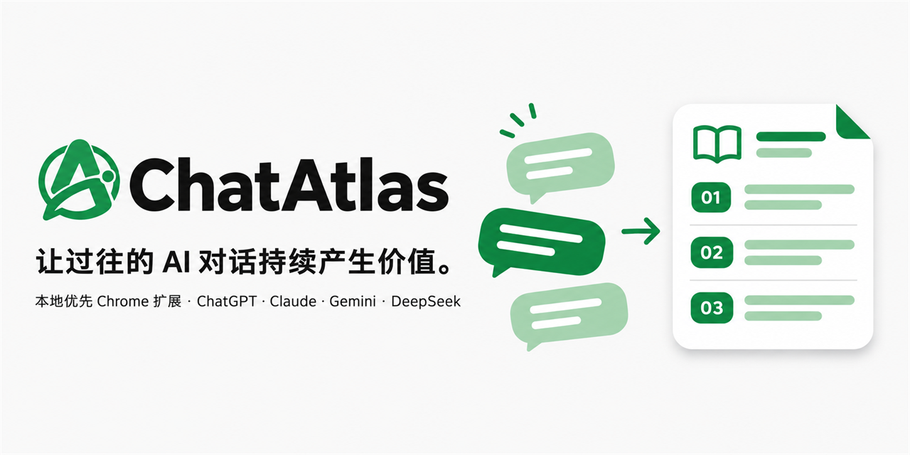
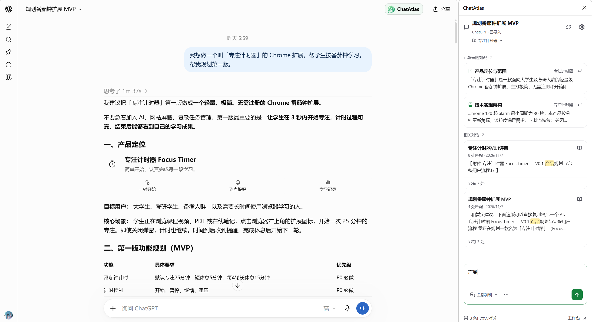
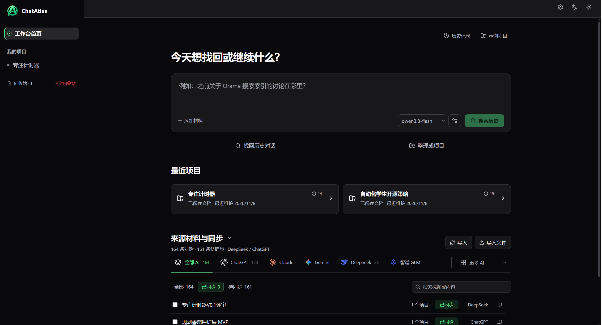
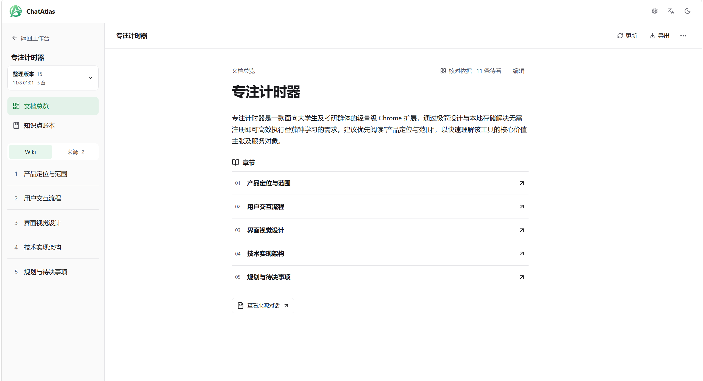
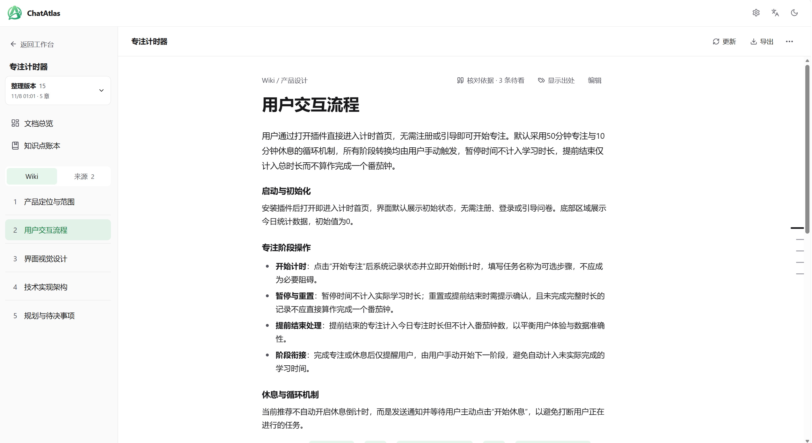
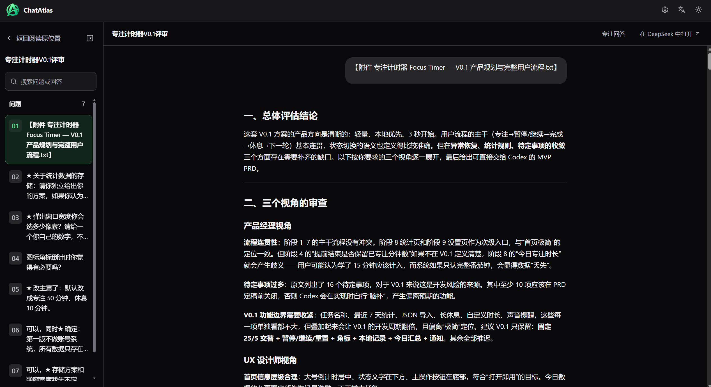
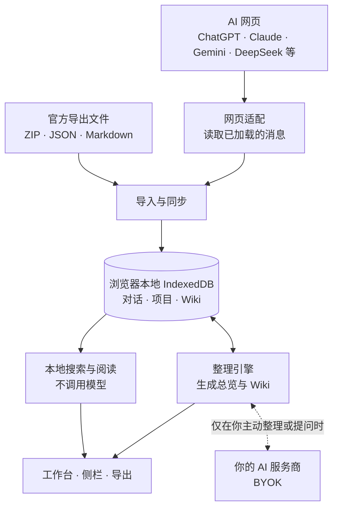

<p align="center">
  
</p>

<p align="center">
  <b>简体中文</b> · <a href="README.en.md">English</a>
</p>

<p align="center">
  <a href="https://github.com/CNZHM666/ChatAtlas/releases/latest"></a>
  <a href="LICENSE"></a>
  
  <a href="https://linux.do"></a>
</p>

<p align="center">
  👋 欢迎来自 <a href="https://linux.do"><b>LINUX DO</b></a> 的佬友！试用后欢迎回帖交流，或在 <a href="https://github.com/CNZHM666/ChatAtlas/issues">Issues</a> 提建议。
</p>

<p align="center">
  <a href="https://github.com/CNZHM666/ChatAtlas/releases/latest"><b>下载最新版</b></a>
  &nbsp;·&nbsp; <a href="#安装约-2-分钟">安装</a>
  &nbsp;·&nbsp; <a href="#第一次使用">第一次使用</a>
  &nbsp;·&nbsp; <a href="#架构概览">架构</a>
  &nbsp;·&nbsp; <a href="CHANGELOG.md">更新记录</a>
  &nbsp;·&nbsp; <a href="https://github.com/CNZHM666/ChatAtlas/issues">反馈</a>
</p>

<br>

**聊过的不再沉底，学过的随时能复习。**

- **装好就能用**：基础搜索不需要 AI Key。导入或保存对话后，在本地按关键词查找标题与正文，阅读原始讨论。
- **数据留在本地**：对话保存在你的浏览器里，没有 ChatAtlas 服务器。整理文档使用你自己的 API（BYOK），材料直接发往你选择的服务商。
- **需要时再整理**：把选定的讨论整理成可追溯来源的项目总览和 Wiki。

> [!NOTE]
> ChatAtlas 是早期预览版（0.1.2 Early Preview）。功能、交互和数据结构仍会调整；Wiki 整理属于实验功能，生成结果需要你对照来源核对。升级前请先备份本地数据。

## 界面预览



<p align="center"><sub>在 AI 网页旁打开侧栏，随时查找已整理的知识和相关对话</sub></p>

| 工作台：搜索历史、整理项目、按 AI 浏览来源 | 项目文档：总览与章节目录 |
| :---: | :---: |
|  |  |
| **Wiki 章节：按主题整理的决定与细节** | **原文阅读：按原来的问答顺序连续阅读** |
|  |  |

## 能做什么

- **保存对话**：导入官方导出文件，或在支持的 AI 网页上自动保存已加载的对话。全部保存在当前浏览器。
- **找回原话**：关键词同时查找标题和正文，打开后按原来的问答顺序连续阅读，可回到原网页定位。
- **当前对话侧栏**：在 AI 网页旁查找本地记录、关联项目，把内容填入输入框（不会自动发送，也不覆盖你已输入的草稿）。
- **整理为 Wiki**：选择对话和目标，生成项目总览与 Wiki；写作前和写作中会就需要你判断的地方提问，写好后先预览再保存。
- **学习记录（测试中）**：手动选择「学习」类型时，按知识点整理你学过的内容、写过的练习、出过的错和回忆题。
- **交给另一个 AI**：把总览和所选章节导出为 Markdown、纯文本、HTML（可打印为 PDF）或 JSON，作为附件继续使用。导出不调用模型。

各入口的分工：

| 入口 | 从哪里进入 | 用途 |
| --- | --- | --- |
| 工作台首页 | 点击扩展图标 | 一个输入框搜索历史讨论，或根据历史回答问题；管理来源材料与同步，继续上次的阅读和项目 |
| 发现主题 | 首页「发现整理主题」 | AI 从最近的对话中找出可以整理的项目和值得复习的主题，每个都列出来源，先核对再开始（需要连接 AI） |
| 对话阅读 | 搜索结果或来源列表 | 按原来的问答顺序阅读完整对话，可回到原网页定位 |
| 项目文档 | 首页「整理为项目文档」 | 选择来源和目标，回答写作前的问题，生成总览与 Wiki；核对、编辑、按需更新、导出 |
| 章节阅读 | 项目文档内 | 沿 Wiki 章节和对应原文连续阅读，读完一章直接进入下一章 |
| 侧栏 | 在 AI 网页旁打开 | 当前对话的本地查找、项目关联，把内容填入输入框 |

常用路径：**搜索或提问 → 阅读原始对话 → 整理为项目文档 → 沿章节和来源阅读 → 导出给其他 AI**。查找、阅读和导出不需要 AI Key。产品取舍依据见[产品准则](PRODUCT_PRINCIPLES.md)。

## 支持的平台

| 方式 | 平台 |
| --- | --- |
| 导入官方导出 | ChatGPT（ZIP/JSON）、Claude、Gemini（Google Takeout JSON）、DeepSeek；其他 AI 的 Markdown／JSON 对话记录 |
| 网页自动保存 | ChatGPT（专用历史列表与正文同步）；Claude、Gemini、DeepSeek、豆包、Kimi、通义千问（含 Qwen 国际站）为试用 |

网页保存在浏览器授予网站权限后默认自动运行，可在「设置 → 采集与数据 → 网页自动采集」按平台暂停或恢复。除 ChatGPT 外，仅保存当前已加载的消息，不保证完整历史；长对话需要先在原网页加载更早的消息。新增平台尚未逐一在登录状态下验收，网站改版可能影响兼容性，届时可改用文件导入。保存对话不调用模型。

## 安装（约 2 分钟）

ChatAtlas 还没有上架 Chrome 应用商店，需要以「开发者模式」加载。Edge 等基于 Chromium 的浏览器步骤相同（地址换成 `edge://extensions`）。也可以把[一段提示词](#让-ai-帮你安装)交给 AI，让它帮你完成。

1. **下载**：打开 [Releases 最新版本](https://github.com/CNZHM666/ChatAtlas/releases/latest)，在 Assets 里下载 `ChatAtlas-extension-v0.1.2.zip`。不要下载 `Source code`，那是源码，不能直接加载。
2. **解压**：把 ZIP 解压到一个固定的文件夹，例如 `文档/ChatAtlas`。解压后的文件夹里应直接能看到 `manifest.json`。加载后不要删除或移动这个文件夹，否则扩展会失效。
3. **打开扩展管理页**：在 Chrome 地址栏输入 `chrome://extensions` 并回车。
4. **开启开发者模式**：打开页面右上角的「开发者模式」开关。
5. **加载扩展**：点击左上角「加载已解压的扩展程序」，选择第 2 步解压出的文件夹（含 `manifest.json` 的那一层）。
6. **固定图标**：点击浏览器工具栏的拼图图标，把 ChatAtlas 固定到工具栏。点击图标即可打开工作台。

Chrome 启动时可能提示「停用开发者模式扩展程序」，选择保留即可。如果加载时提示「清单文件缺失或不可读取」，说明选错了层级，请选择直接包含 `manifest.json` 的文件夹。

**升级到新版本**：先在「设置 → 采集与数据」下载备份（不含 API Key）；然后用新 ZIP 的内容覆盖原文件夹，在 `chrome://extensions` 点击 ChatAtlas 卡片上的刷新按钮。本地数据保存在浏览器里，覆盖文件不会删除它们；但不要点「移除」，移除扩展会清空本地数据。

### 让 AI 帮你安装

不熟悉开发者模式也没关系：把下面这段话复制给 AI 助手即可。能操作电脑的 AI（如 Claude Code、Codex）可以替你下载、解压并核对文件；网页版 ChatGPT、Claude、DeepSeek 等会一步步带你完成，遇到报错也可以直接问它。最后在 `chrome://extensions` 里开启开发者模式和加载扩展这两步，通常需要你自己点。

```text
请帮我安装 Chrome 扩展 ChatAtlas（开源项目：https://github.com/CNZHM666/ChatAtlas）。

1. 打开 https://github.com/CNZHM666/ChatAtlas/releases/latest ，在 Assets 里下载名为 ChatAtlas-extension-v版本号.zip 的文件。只用这个官方地址，不要下载 Source code，也不要从其他网站下载。
2. 把 ZIP 解压到一个以后不会删除或移动的文件夹（例如 文档/ChatAtlas），确认这个文件夹里直接有 manifest.json。
3. 告诉我这个文件夹的完整路径，然后指导我：在 Chrome 地址栏打开 chrome://extensions，开启右上角的「开发者模式」，点击「加载已解压的扩展程序」，选择这个文件夹，最后把 ChatAtlas 图标固定到工具栏。

如果你不能直接操作我的电脑，请把每一步写清楚让我照做；如果出现报错，帮我判断原因。不要修改扩展里的任何文件，也不要让我提供任何密码或 API Key。
```

## 第一次使用

1. 点击扩展图标打开工作台，导入官方导出文件，或打开支持的 AI 网页让它自动保存。
2. 查找和阅读不需要 API Key。要整理文档，先在「设置 → AI 连接」选择服务商、填入你的 Key、选择模型并测试连接。
3. 整理为项目文档：选择来源、写下目标、回答写作前的问题，生成后核对并保存。

不要把私人备份或导出文件提交到 GitHub。

## Wiki 怎样整理

1. **选择材料**：勾选来源对话（一次最多 24 条，可跨平台），写下你想整理的目标。
2. **写作前确认**：列出材料里提到的其他项目和产品，你可以直接勾选不写入 Wiki 的项目，不需要模型判断；模型再就少数会影响结论的地方提问，比如两份路线图哪份算数、某条限制属于哪个阶段。你的回答优先于 AI 的推断。
3. **边写边问**：写作中发现说不清的地方会即时补问，回答后只改相关段落，不重写整章。
4. **核对与保存**：先预览，再保存。之后可以单章重写或按新材料更新，你的个人修改受保护。

生成的文档包括：

- **项目总览**：一页速览、**当前基线**（现在做／暂不做／完成标准）、已定的关键决定和来源范围。
- **Wiki 章节**：按主题组织，同一点只解释一次；保留原文中的数字、代码和适用条件。
- **句末标记**：〔已定〕你确认的决定，〔未定〕仍在讨论，〔此前〕已被取代的方案，〔你〕你的看法或报告，〔资料〕你粘贴的资料。没有标记的是 AI 的建议或分析。“已完成”只代表你的报告，不代表代码已核验。
- **文档信息与核对说明**：列出来源范围、自动检查结果和未抽出知识点的消息。自动检查可能误报，也可能漏报。

引用用于回到原文核对，不证明建议已被采纳。整理长材料需要较多时间和 Token；成功的阅读和写作结果会按输入复用，失败时保留已完成的部分。

## 架构概览

ChatAtlas 是一个纯前端的 Manifest V3 扩展：所有数据都在你的浏览器里流转，只有你主动整理文档或提问时，所选材料才会直接发往你自己配置的 AI 服务商。



| 模块 | 职责 |
| --- | --- |
| `src/content/` | 适配各 AI 网页：保存已加载的对话、原文定位、把内容填入输入框 |
| `src/background/` | 扩展入口、网站权限、同步调度 |
| `src/sync/` · `src/storage/` | 导入官方导出与网页历史，存入 IndexedDB，保留来源版本 |
| `src/search/` | 标题与正文的本地全文搜索和排序 |
| `src/ai/` | BYOK 服务商连接，Wiki 的初读、目录规划、写作与来源校验 |
| `src/canvas/` · `src/sidecar/` | 工作台、阅读器、项目文档界面，以及 AI 网页旁的侧栏 |
| `src/export/` | 把总览与章节导出为 Markdown、纯文本、HTML、JSON |

设计上的几条约束：

- **原文优先**：生成的解释、原始对话和你的个人修改分开保存；结论附带来源，可以回到原文核对。
- **AI 提建议，你做决定**：保存文档不会把 AI 的建议升级成你的决定；你改过的章节在更新时受保护。
- **不越界**：不自动发送消息，不覆盖输入框里的草稿，不在后台调用模型。

更多细节见[架构说明](ARCHITECTURE.md)和[AI 工作流](AI_WORKFLOWS.md)。

## 数据与隐私

- 对话、项目、收藏和 AI 设置保存在当前浏览器，没有云同步，也没有 ChatAtlas 服务器。
- 只有你主动使用 AI（整理、语义检索）时，相关材料才会直接发往你选择的服务商。
- 查找、阅读和导出都不调用模型。
- 卸载扩展或清理浏览器数据前请先备份。

详见[隐私说明](docs/PRIVACY.md)；发现安全问题请按[安全策略](SECURITY.md)私下报告。

## 当前限制

- Wiki 质量会随材料和模型变化，同一份材料多次生成的结果也可能不同；关键结论请回到原文核对。
- 自动化测试使用模拟服务商，不能证明真实长对话的完整率、费用或每个模型的成功率。
- 网页自动保存依赖各网站的页面结构，平台改版可能导致暂时失效。
- 整理所需时间取决于材料长度、模型和服务商限流，长材料可能需要较长时间；目前没有可公布的基准数据。查找与阅读不需要生成。
- **学习模式（测试中）**：在整理类型中手动选择「学习（测试中）」，可把学习类对话整理为按章节编号的知识卡片、练习、易错点和回忆题。排版和抽取规则仍在调整，「自动」目前只会按项目整理。

## 从源码运行

使用 Node.js 22 和 npm：

```bash
npm ci
npm run check
```

然后在 Chrome 加载 `dist/`。日常开发运行 `npm run dev` 并加载 `dist-dev/`。不需要 `.env` 或后端服务。

```bash
npm run check:public
npm run eval:wiki -- <cases.json> <export.md>
```

`check:public` 检查公开源码中没有凭据、本机路径或清单外的文件。`eval:wiki` 用你自己标注的用例给导出的 Wiki 打分，多份导出会取平均；用例和导出含私人内容，应保留在本地。发布步骤见[发布清单](docs/RELEASE_CHECKLIST.md)。

## 文档与反馈

[使用指南](docs/GETTING_STARTED.md) · [文档目录](docs/README.md) · [项目导出](docs/CONTEXT.md) · [架构](ARCHITECTURE.md) · [AI 工作流](AI_WORKFLOWS.md) · [贡献指南](CONTRIBUTING.md) · [安全策略](SECURITY.md) · [更新记录](CHANGELOG.md)

英文文档见 [English documentation](docs/en/README.md)。

欢迎通过 Issues 提交可复现的问题：注明扩展与浏览器版本、导入方式、模型、步骤和预期结果，并删除 API Key 和私人对话内容。功能想法请用「功能建议」模板提交。

## 社区

欢迎在 [LINUX DO](https://linux.do) 社区交流使用体验、分享整理出的 Wiki 或提出建议，也可以在 [GitHub Discussions](https://github.com/CNZHM666/ChatAtlas/discussions) 讨论。感谢 LINUX DO 社区的支持。

## 许可证

[MIT](LICENSE)。第三方组件保留各自许可证，见[依赖声明](docs/THIRD_PARTY_NOTICES.md)。
