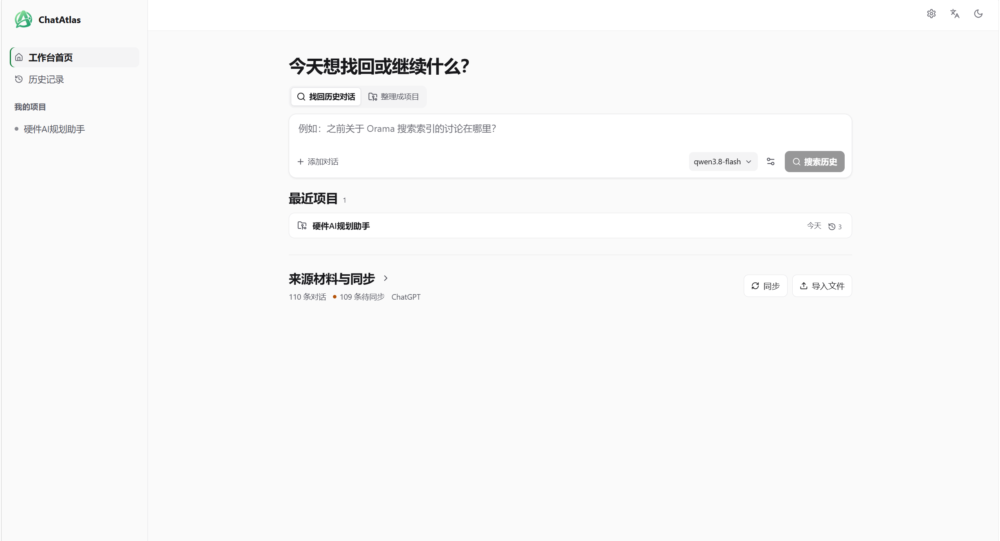
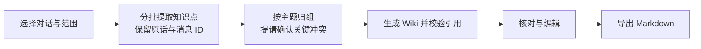

<p align="center">
  
</p>

<p align="center">
  <b>简体中文</b> · <a href="README.en.md">English</a> · <b>v0.1.7 Alpha</b>
</p>

<p align="center">
  <a href="https://github.com/CNZHM666/ChatAtlas/releases/download/v0.1.7/ChatAtlas-extension-v0.1.7.zip"><b>下载 v0.1.7 安装包</b></a>
  · <a href="#效果预览">效果预览</a>
  · <a href="#安装到-chrome-或-edge">安装</a>
  · <a href="CHANGELOG.md">更新记录</a>
  · <a href="https://github.com/CNZHM666/ChatAtlas/issues">反馈</a>
</p>

<p align="center">
  <strong>把散落在多个 AI 长对话里的项目讨论，整理成可核对原话、可增量更新的项目 Wiki。</strong><br>
  按需导出 Markdown，直接交给队友、<strong>Codex</strong> 或 <strong>Claude Code</strong> 接着做。
</p>

> [!NOTE]
> **Alpha 测试版 · Chrome / Edge** · 本地阅读、关键词搜索与导出无需 AI Key。生成 Wiki 采用 BYOK（自带模型 API）。早期版本处理超长对话可能较慢，生成质量随模型与材料而变，请通过内置溯源核对关键结论，升级前先备份。

## 为什么用 ChatAtlas

- **区分结论，原话一键溯源。** 已确认决定、AI 建议与用户报告分别标记。打开「核对依据」即可查看原话及前后文，遇到关键冲突时由你拍板确认。
- **知识点账本与增量更新。** 分批提取知识点并关联原始消息 ID。后续补充对话时，复用符合条件且已通过检查的读取结果，补读聚焦遗漏材料，应用变更前可先预览受影响的章节。
- **导出 Markdown，无缝交接。** 按需勾选项目总览和指定章节导出 `.md`（可保留引用编号或附上原话），直接作为项目上下文交给队友、Codex 或 Claude Code。[查看 Markdown 模板 →](docs/examples/project-context-template.md)
- **本地优先，按需调用 AI。** 对话、账本与 Wiki 均保存在浏览器 IndexedDB 中。阅读、关键词搜索与导出在本地完成。主动生成或更新 Wiki 时，所选范围内的必要材料直接发往你配置的模型服务商。

## 效果预览

<p align="center">
  
  <br><sub>开启「显示出处」，点击正文来源标记即可定位原始对话</sub>
</p>

<p align="center">
  
  <br><sub>在 Wiki 右侧核对结论，查看对应的原话和前后文</sub>
</p>

<details>
<summary>点击查看导入演示与更多界面截图</summary>

<p align="center">
  
  <br><sub>在工作台导入多平台对话</sub>
</p>

| 项目总览 | 暗色阅读器 |
|:---:|:---:|
|  |  |
| **工作台** | **网页侧栏** |
|  |  |

</details>

## 快速上手

1. **选择材料**。在「设置 → AI 连接」配置并测试模型。导入对话后，在工作台点击「整理为项目文档」，勾选来源并写下目标。
2. **核对依据**。打开章节的「核对依据」，对照原话和前后文，确认会影响后续工作的结论。
3. **导出 Markdown**。在「导出」中勾选总览和所需章节，按需附上引用原话，再分享给队友或交给 Coding Agent。

## 支持的平台与来源

| 来源 | 文件导入 | 网页自动保存 |
| :--- | :--- | :--- |
| **ChatGPT** | ✅ 官方导出 | ✅ 支持，另有专用历史同步 |
| **Claude** | ✅ 官方导出 | 🧪 试用 |
| **Gemini** | ✅ Google Takeout JSON | 🧪 试用 |
| **DeepSeek** | ✅ 官方导出 | 🧪 试用 |
| **豆包** | — | 🧪 试用 |
| **Kimi** | — | 🧪 试用 |
| **通义千问（含 Qwen 国际站）** | — | 🧪 试用 |
| **通用 Markdown / JSON** | ✅ 兼容的对话文件 | — |

浏览器授予对应网站权限后，网页保存默认启用，可在设置中随时暂停。标注「试用」的平台仅保存当前已加载的消息，更早的历史可能尚未加载。

## 工作原理与架构



- **原文与整理结果隔离存储。** 原始消息和来源版本、生成内容及个人编辑分别保留。每条确认记录绑定原问题、所选答案与对应依据。
- **更新保护个人编辑。** 对于你手动改过的章节，增量更新会保留原稿，并将新生成的变更作为建议供预览。
- **BYOK 请求直连服务商。** API 密钥保存在本地浏览器。生成 Wiki、可选语义增强、侧栏 AI 问答和连接测试的请求均由浏览器直接发往你配置的服务商。

[架构说明](ARCHITECTURE.md) · [AI 工作流](AI_WORKFLOWS.md) · [隐私说明](docs/PRIVACY.md)

## 安装到 Chrome 或 Edge

**[下载 v0.1.7 Alpha 安装包（ZIP）](https://github.com/CNZHM666/ChatAtlas/releases/download/v0.1.7/ChatAtlas-extension-v0.1.7.zip)** · [查看发布说明](https://github.com/CNZHM666/ChatAtlas/releases/tag/v0.1.7)

Chrome 和 Edge 共用同一个 ZIP。Alpha 测试版现阶段通过 GitHub 发布，需在浏览器中手动加载。

1. 下载并解压 ZIP 到一个**长期保留**的固定文件夹。
2. 在地址栏打开 `chrome://extensions` 或 `edge://extensions`，启用「开发者模式」。
3. 点击「加载已解压的扩展程序」，选中直接包含 `manifest.json` 的文件夹。安装后可从浏览器的扩展菜单打开或固定 **ChatAtlas**。

<details>
<summary>使用 Claude Code / Codex 一句话辅助下载与解压</summary>

将下面这段提示词发给具备终端能力的 AI 助手，再按其返回的路径在浏览器中加载即可。

```text
请从以下地址下载 ChatAtlas v0.1.7 Alpha 的扩展安装包。
https://github.com/CNZHM666/ChatAtlas/releases/download/v0.1.7/ChatAtlas-extension-v0.1.7.zip
解压到一个长期保留的固定文件夹里，确认目录内直接包含 manifest.json，然后告诉我该文件夹的绝对路径并引导我在 Chrome 或 Edge 中加载。
```

</details>

**升级旧版**。先在「设置 → 采集与数据」导出备份，再用新版文件替换原安装目录中的文件，最后在扩展管理页刷新 ChatAtlas。

## 从源码运行

需要 **Node.js 22**。

```sh
npm ci
npm run check   # 检查并构建，随后在浏览器加载 dist/
npm run dev     # 启动开发模式，在浏览器加载 dist-dev/
```

[使用指南](docs/GETTING_STARTED.md) · [贡献指南](CONTRIBUTING.md) · [MIT 许可证](LICENSE) · [第三方声明](docs/THIRD_PARTY_NOTICES.md)

## 社区与共建

欢迎在 [LINUX DO](https://linux.do) 或 [GitHub Discussions](https://github.com/CNZHM666/ChatAtlas/discussions) 分享使用体验、整理出的 Wiki 或改进建议，也欢迎提交 [Issues](https://github.com/CNZHM666/ChatAtlas/issues) 与 PR 一起完善这个项目（详见[贡献指南](CONTRIBUTING.md)）。感谢 LINUX DO 社区的支持。
