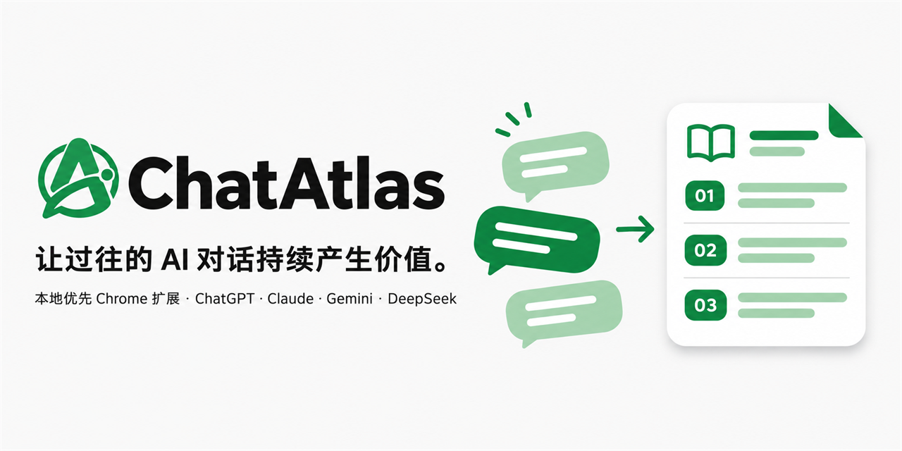
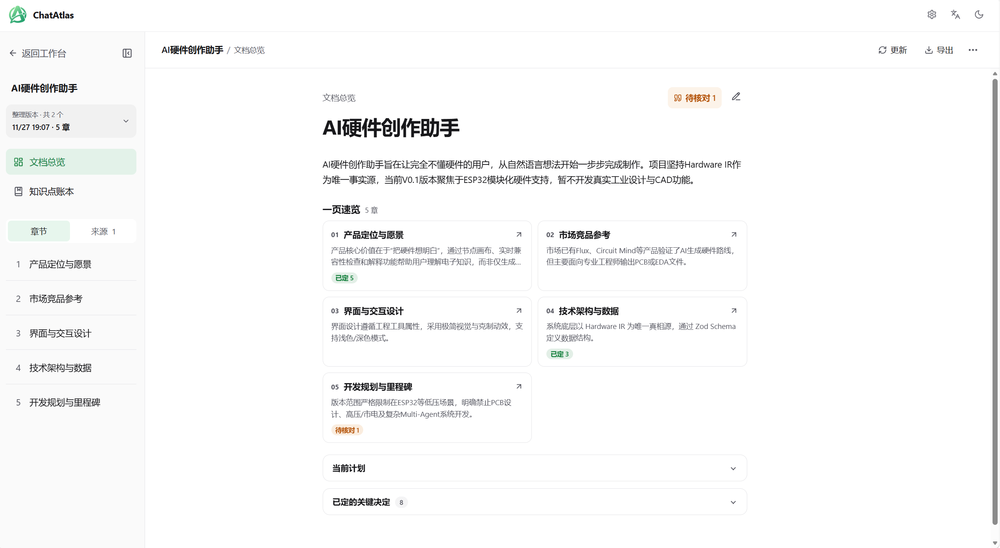
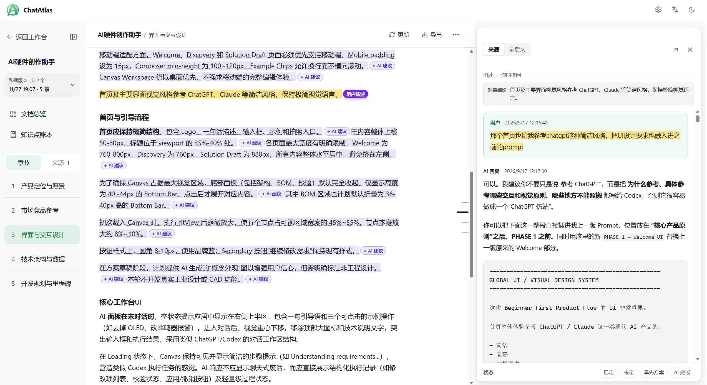
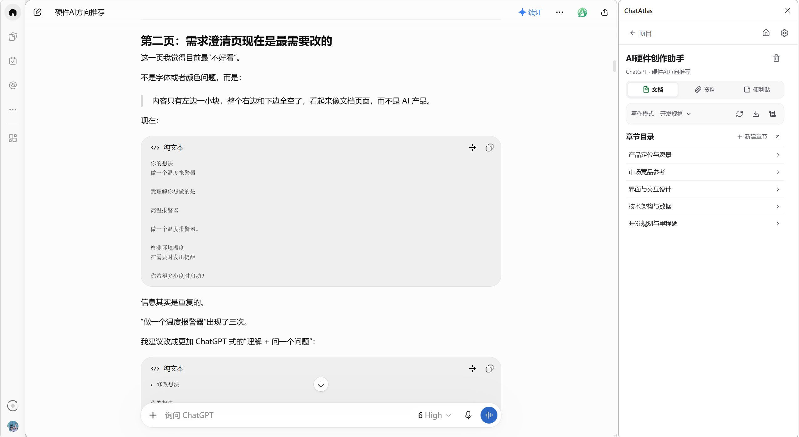
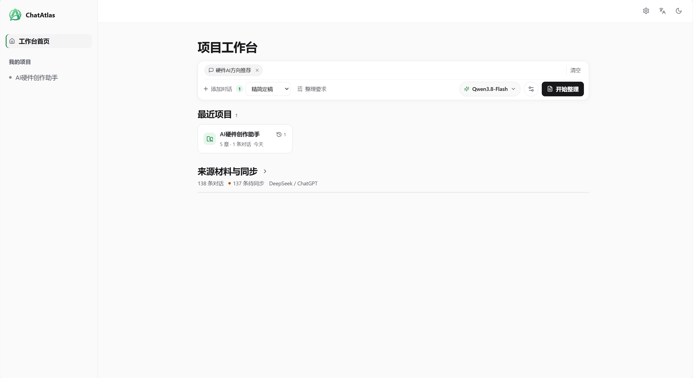
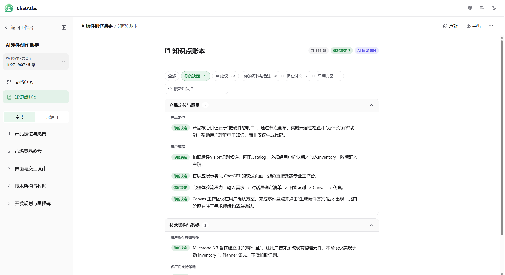
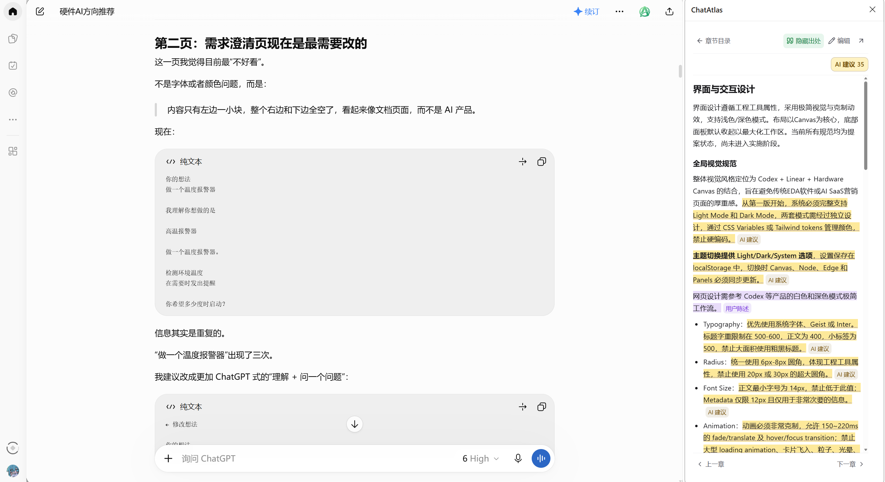
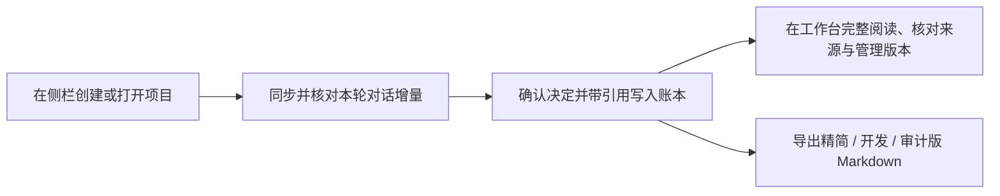

<p align="center">
  
</p>

<p align="center">
  <a href="README.md">English</a> · <b>简体中文</b> · <b>v0.1.8 Alpha</b>
</p>

<p align="center">
  <a href="https://cnzhm666.github.io/ChatAtlas/?lang=zh#/wiki/operation-plans"><b>在线体验</b></a>
  · <a href="https://github.com/CNZHM666/ChatAtlas/releases/download/v0.1.8/ChatAtlas-extension-v0.1.8.zip">下载 v0.1.8 安装包</a>
  · <a href="#效果预览">效果预览</a>
  · <a href="#安装到-chrome-或-edge">安装</a>
  · <a href="CHANGELOG.md">更新记录</a>
  · <a href="https://github.com/CNZHM666/ChatAtlas/issues">反馈</a>
</p>

<p align="center">
  <strong>在 ChatGPT 开始，去 Claude 接着做。把跨平台 AI 对话持续沉淀为一份可核对原话的项目 Markdown。</strong><br>
  本地优先的 Chrome / Edge 扩展。将多平台 AI 对话整理为带原话定位的项目 Wiki、知识点账本与项目资料区，支持精简 / 开发 / 审计三种 Markdown 导出，直接交给队友、<strong>Codex</strong> 或 <strong>Claude Code</strong>。
</p>

> [!NOTE]
> **Alpha 测试版 · Chrome / Edge** · 本地阅读、关键词搜索、项目资料、便利贴与导出均无需 AI Key。生成与增量更新采用 BYOK（自带模型 API）。请通过内置出处核对关键结论，升级前先备份本地数据。

## 为什么用 ChatAtlas

- **在 AI 对话旁直接工作的原生侧栏。** 在浏览器侧栏新建项目、核对本轮对话增量、按章内大纲阅读文档并核对出处；内置独立的**「资料」**（支持拖入、粘贴及自动收录当前对话上传的文件）与**「便利贴」**标签，不污染正式文档。
- **工作台提供完整阅读、账本与来源核对。** 一页总览快速把握项目全貌与待决事项；在**「知识点账本」**中按「你的决定 / AI 建议 / 仍在讨论 / 早期方案」清晰筛选；点开任意出处标记即可并排对照原话与前后文。
- **精简 / 开发 / 审计三种 Markdown 导出（支持复制与下载）。** 在侧栏和工作台均可直接切换 **精简（Brief）**、**开发（Handoff）** 和 **审计（Audit）** 模式，一键复制 Markdown 或下载 `.md`，无需重新生成。[查看 Markdown 模板 →](docs/examples/project-context-template.md)
- **本地优先，按需调用 AI。** 原始对话、知识点账本、Wiki 版本、项目资料与便利贴均保存在浏览器 IndexedDB 中；阅读、关键词查找与导出完全本地运行。仅在你主动生成或更新时，将所选材料直连发往你配置的模型服务商。

## 效果预览

**[在线体验中文示例](https://cnzhm666.github.io/ChatAtlas/?lang=zh#/wiki/operation-plans)** · 无需安装或配置模型即可体验。

<p align="center">
  
  <br><sub>项目文档总览：一页速览章节卡片、已定决策数量与待核对提醒</sub>
</p>

<p align="center">
  
  <br><sub>来源核对：正文归属标注与右侧原始对话摘录、前后文并排对照</sub>
</p>

<p align="center">
  
  <br><sub>原生侧边栏：文档 / 资料 / 便利贴三标签、写作模式切换、增量更新与三模式导出</sub>
</p>

<details>
<summary>查看更多界面截图：工作台首页、知识点账本与侧栏章节阅读</summary>

| 项目工作台首页 | 知识点账本 |
|:---:|:---:|
|  |  |
| **侧栏章节阅读与出处标注** | **侧栏项目与资料工作区** |
|  |  |

</details>

## 快速上手

1. **创建或整理项目。** 在支持的 AI 网页打开 ChatAtlas 原生侧栏点「新建」，或在**项目工作台**选择已有对话开始整理。首次生成前在「设置 → AI 设置」配置模型连接。
2. **生成首版与核对增量。** 侧栏支持后台静默生成首版文档；继续讨论后点更新图标即可预览新增与变更条目，逐条核对原话后写入。
3. **沉淀项目资料与便利贴。** 切换到侧栏「资料」标签，开启「自动收录本页上传」（或直接拖入 / `Ctrl+V` 粘贴文件），随时拖拽复用到任意 AI 输入框；零散想法记在「便利贴」。
4. **按需导出 Markdown。** 在侧栏或工作台点击「导出」，按需切换**精简 / 开发 / 审计**模式，一键复制或下载 `.md` 交给队友、Codex 或 Claude Code。

## 支持的平台与来源

| 来源 | 文件导入 | 网页自动保存与原生侧栏 |
| :--- | :--- | :--- |
| **ChatGPT** | ✅ 官方导出 | ✅ 支持，另有专用历史同步 |
| **Claude** | ✅ 官方导出 | 🧪 试用 |
| **Gemini** | ✅ Google Takeout JSON | 🧪 试用 |
| **DeepSeek** | ✅ 官方导出 | 🧪 试用 |
| **豆包** | — | 🧪 试用 |
| **Kimi** | — | 🧪 试用 |
| **通义千问（含 Qwen 国际站）** | — | 🧪 试用 |
| **通用 Markdown / JSON** | ✅ 兼容的对话文件 | — |

浏览器授予对应网站权限后，网页采集默认启用。要停止采集某个网站，可在浏览器中调整 ChatAtlas 的网站访问权限。标注「试用」的平台仅保存当前已加载的消息，更早的历史可能尚未加载。

## 工作原理与架构



- **原文、整理结果与个人维护隔离存储。** 原始消息与来源版本、知识点账本、生成章节、手动编辑、项目资料和便利贴分别保存；每条确认记录完整绑定原问题、选择与依据原话。
- **更新保护个人编辑。** 手动改过的章节不会被静默覆盖；增量更新先预览、后写入，支持撤销上次写入。
- **BYOK 请求直连服务商。** API 密钥仅保存在本地浏览器；生成、增量预览、可选语义增强和连接测试由浏览器直接发往你配置的服务商。

[架构说明](ARCHITECTURE.md) · [AI 工作流](AI_WORKFLOWS.md) · [隐私说明](docs/PRIVACY.md)

## 安装到 Chrome 或 Edge

**[下载 v0.1.8 Alpha 安装包（ZIP）](https://github.com/CNZHM666/ChatAtlas/releases/download/v0.1.8/ChatAtlas-extension-v0.1.8.zip)** · [查看发布说明](https://github.com/CNZHM666/ChatAtlas/releases/tag/v0.1.8)

Chrome 和 Edge 共用同一个 ZIP。Alpha 测试版现阶段通过 GitHub 发布，需在浏览器中手动加载。

1. 下载并解压 ZIP 到一个**长期保留**的固定文件夹。
2. 在地址栏打开 `chrome://extensions` 或 `edge://extensions`，启用「开发者模式」。
3. 点击「加载已解压的扩展程序」，选中直接包含 `manifest.json` 的文件夹。安装后可从浏览器的扩展菜单打开或固定 **ChatAtlas**。

<details>
<summary>使用 Claude Code / Codex 一句话辅助下载与解压</summary>

将下面这段提示词发给具备终端能力的 AI 助手，再按其返回的路径在浏览器中加载即可。

```text
请从以下地址下载 ChatAtlas v0.1.8 Alpha 的扩展安装包。
https://github.com/CNZHM666/ChatAtlas/releases/download/v0.1.8/ChatAtlas-extension-v0.1.8.zip
解压到一个长期保留的固定文件夹里，确认目录内直接包含 manifest.json，然后告诉我该文件夹的绝对路径并引导我在 Chrome 或 Edge 中加载。
```

</details>

**升级旧版**。先在「设置 → 本地数据」导出备份，再用新版文件替换原安装目录中的文件，最后在扩展管理页刷新 ChatAtlas。

## 从源码运行

需要 **Node.js 22**。

```sh
npm ci
npm run check   # 检查并构建，随后在浏览器加载 dist/
npm run dev     # 启动开发模式，在浏览器加载 dist-dev/
```

[使用指南](docs/GETTING_STARTED.md) · [贡献指南](CONTRIBUTING.md) · [MIT 许可证](LICENSE) · [第三方声明](docs/THIRD_PARTY_NOTICES.md)

## 社区与共建

欢迎在 [LINUX DO](https://linux.do) 或 [GitHub Discussions](https://github.com/CNZHM666/ChatAtlas/discussions) 分享使用体验、整理出的 Wiki 或改进建议，也欢迎提交 [Issues](https://github.com/CNZHM666/ChatAtlas/issues) 与 PR 一起完善这个项目（详见[贡献指南](CONTRIBUTING.md)）。感谢 LINUX DO 社区的支持。
