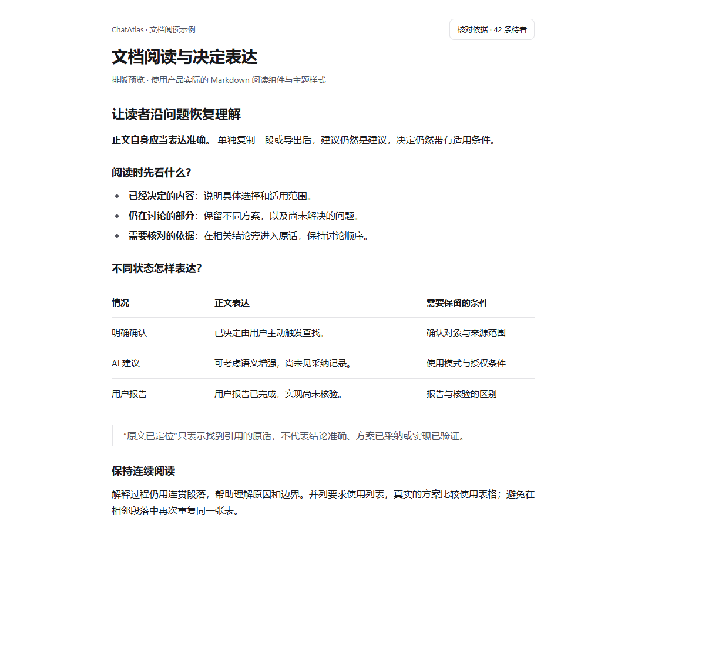
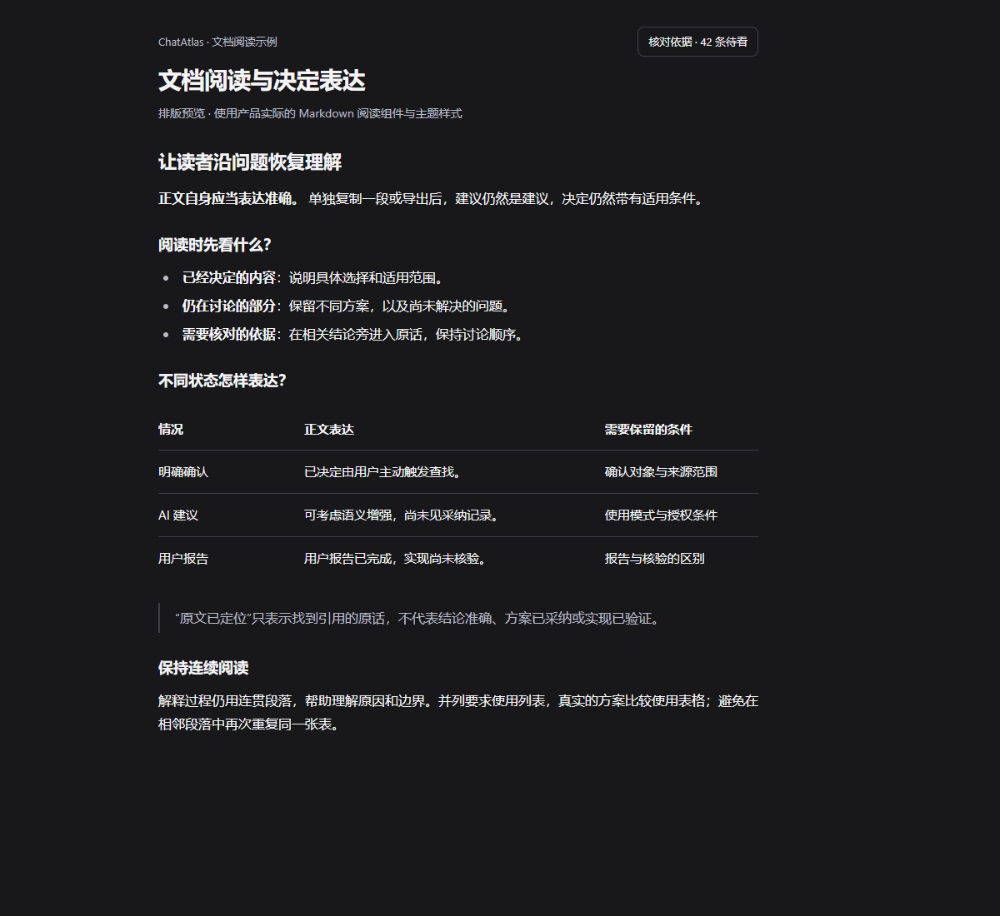
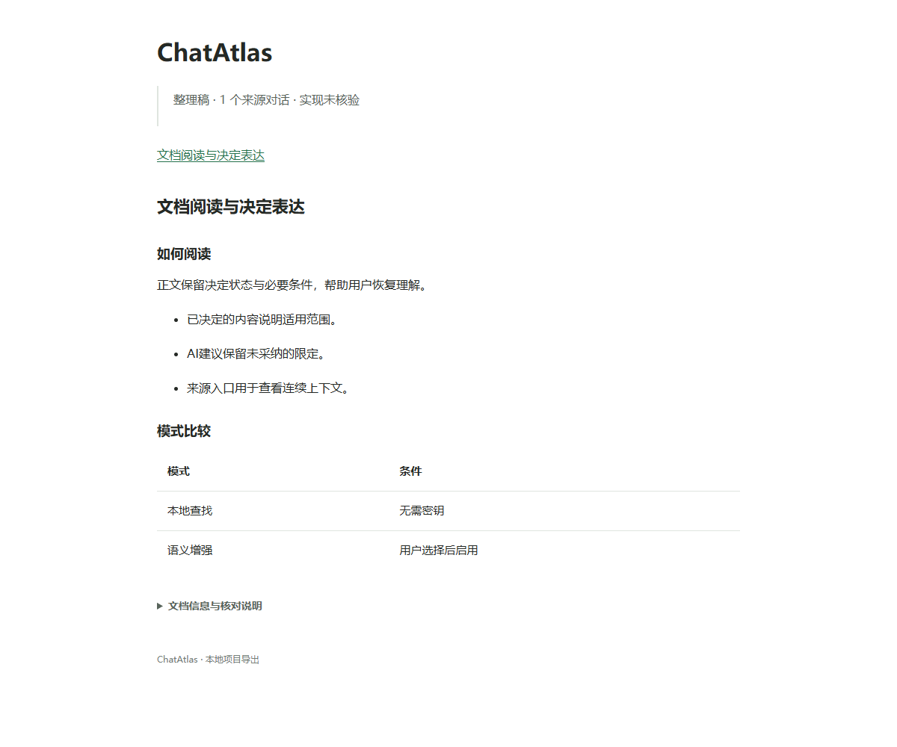

# ChatAtlas：文档阅读与状态表达交接

日期：2026-10-31。用途：供 Claude 或维护者接手本轮工作。

## 提交范围

该分支保存当前可运行的 Wiki 工作快照，基于本地 `wiki-phase1-combined` 的已有历史。开始本次任务时，工作区已存在尚未提交的 Wiki 整理、语义合并、范围确认、设置与质量指标改动；本轮的写作、阅读和导出修改依赖其中一部分结构，因此快照一并保留这些前置改动，不将其全部归为本轮新实现。

这次明确新增的工作是：文档可读性设计、状态措辞保留、核对入口命名、导出状态保留，以及用户指定的 Markdown 视觉排版。项目产品原则以根目录 `PRODUCT_PRINCIPLES.md` 为准。

私人对话导出、运行分析 CSV、机器配置、临时预览工程与本地完整诊断报告不在本次提交范围内。下方截图使用示例内容与实际阅读组件，不是用户私人对话。

## 本轮行为变化

| 问题 | 修改后的行为 | 主要位置 |
| --- | --- | --- |
| 后处理删除“已决定／仍在讨论／AI 建议”等语义限定 | 新生成正文保留必要状态与出处措辞；本地修复只纠正缺乏确认依据的决定表述 | `src/ai/wiki-knowledge-write.ts` |
| 相邻要求借用一个已定结论的状态 | 根据具体结论绑定的知识点保守修复，保留已有确认内容 | 同上 |
| 查到引用被称为“依据已核对” | 改为“原文已定位”，明确不等于解释准确、采纳或实现核验 | `src/canvas/components/WikiDocument.tsx` |
| 阅读记录与采纳混淆 | “标记原文已看过”只记录阅读；保留个人表述不记录采用；决定状态操作单独命名 | `WorkspaceSourcePanel.tsx`、`WikiDocument.tsx` |
| 隐藏出处或导出选项使状态消失 | 收起高亮时保留状态标签；Markdown、HTML、纯文本、JSON 导出保留已保存状态 | `wiki-holder.ts`、`project-document.ts`、`ProjectExportDialog.tsx` |
| 历史资料被称为“当前决定” | 改为“所选讨论中的决定”，限定其来源范围 | `src/shared/wiki-key-claims.ts` |
| 普通核对入口呈棕色，像警告 | 待看按钮使用主题中性色，数量保留；具体依据问题仍有就近提示 | `workspace-source-panel.css` |
| 全文偏长段落 | 写作规则允许短段落、并列规则列表和真实比较表格，保留状态、条件与证据 | `wiki-knowledge-write.ts` |

既有正文没有自动重写。更新的写作规则用于之后的生成／重新写作；现有正文直接使用新的阅读样式，已保存的语义标签继续保留。

## 用户确认的视觉方向

使用接近 Markdown 报告的轻量排版，通过层级和留白组织内容。

- 正文：16px、400 字重、1.75 行高。
- 重点短语、表头及标题：600 字重。
- 文档标题：响应式 26–34px；正文内主要标题 22px，次级标题 18px。
- 表格：15px，无外框、圆角、竖线或表头底色，仅细横向分隔线。
- 表格窄屏时在自身区域内横向滚动，可用键盘操作；聚焦轮廓仍保留。
- 引用：透明背景和轻竖线；标题不增加装饰线。
- 页头：大标题与下方说明分层，调整字重和间距；来源日期、事实截止日期和生成时间不得混同，不添加虚构元信息。

主要样式文件：`src/canvas/reader-guide-prose.css`、`src/canvas/document-overview.css`。阅读组件的表格增加了保留原生表格语义的滚动区域，见 `ReaderGuide.tsx`。

## 示例截图

## 验证

最终快照验证：lint、模块可达性、类型检查、512 个测试文件／3233 项测试、生产构建和 Worker 构建验证通过；交接文件按公开源码清单放入 docs/handoff 后，公开源码检查通过（1310 个公开文件）。

此前已完成：

- 完整项目检查通过，512 个测试文件、3233 项测试通过。
- 写作与 Markdown 阅读针对性测试 99 项通过。
- 最近一次纯样式细化后生产构建通过。
- 实际浏览器检查了浅色／深色和 1200px／390px 四种布局；确认正文 400、重点与标题 600、表格无外框／底色／竖线、页面不横向溢出、宽表格可键盘滚动。

真实模型生成质量对照、真实用户阅读测试尚未进行。现有模型模拟测试不等于真实模型验收。

## 后续工作与注意事项

1. 使用固定来源快照测试两个代表性章节：产品定位检查重复与主次，核心工作流检查混合状态、历史与条件保留。
2. 分开评估出处、决定、适用范围和实施证据。当前仍兼容既有 holder 数据模型，完整的四维模型尚未迁移。
3. 不把普通建议全部加入待审批队列；先关注无依据的确定表述、旧方案误作现行方案和关键条件丢失。
4. 报告的后续阶段（整本文档重组、语义重复评测、生成流程效率校准）仍为规划，不应标为已完成。
5. 更新先预览并保护个人编辑；保存、看过原文和保留现稿都不自动代表采纳。
6. 阅读、复制与导出应保留状态、否定、对象、版本和模式条件。导出不调用模型重新总结。

本分支用于审阅和交接，没有部署或修改共享后端。

## 后续优化：结构化正文与精简导出页头

本轮补充了可执行的结构化写作接口，而不只在提示词中允许 Markdown：

- 每节根据实际材料附带布局建议；模型可返回 paragraph、list、comparison 三种内容块。列表项和表格行分别绑定来源知识点，再编译为现有 Markdown 保存结构。
- 不完整表格、未知来源编号、通过换行注入额外行、超长结构块会被拒绝，不静默删掉行或条件。沿用已有有界重试，不额外增加全量排版模型调用。
- 仍兼容原有 paragraphs 返回结构。该兼容入口不能证明真实模型已经稳定采用列表／表格，需要后续真实来源测试。
- 本地修复覆盖加粗的“确定项目名”等没有确认依据的命名表述，保留有依据的决定。
- MD 正文不再重复输出项目一级标题；项目名保留在完整文档信息中。独立 HTML 仍有一个主标题。
- 首屏仅保留简短状态与必要的范围警告。完整来源、保存时间、核验边界和标记解释移到文末；HTML 中默认折叠。
- 元信息不计入 Wiki 章节和质量指标，侧栏插入也不夹带导出说明。导出不会调用模型重新组织已保存正文。
- HTML 导出同步使用无外框表格与轻量标题排版。

验证补充：完整项目检查中 513 个测试文件、3242 项测试通过；结构化输出到保存账本再到 MD／HTML 导出的集成验证通过。实际浏览器验证了导出 HTML 的单一主标题、文末说明默认收起及可展开，覆盖桌面和窄屏。真实模型产物质量与真实用户阅读测试仍待验证。

